# The first 50 posts

The first 50 social posts for The Home Lab, from launch on Friday 6 November 2026 to 21 January 2027. Every post has a finished creative in `creatives/`, made only from the supplier photos of the actual pieces, the brand fonts and the brand colours. Nobody needs to be on camera, record a voice or hold a sample.

This file and `social-calendar.csv` are generated from `tools/posts.mjs`. To change a post, edit it there and run:

```bash
node marketing/tools/render.mjs && node marketing/tools/build-docs.mjs
```

## How to post these

- **Carousels and statics**: upload the slides in order. Sizes are 1080 × 1350 (4:5) for the feed, 1080 × 1920 for Stories and 1000 × 1500 for Pinterest.
- **Reels**: upload `reel.mp4`. It is silent on purpose: add the music in the Instagram or TikTok app from the **commercial music library** (business accounts cannot use the general library, and ads cannot use trending songs). Use `frame-01.jpg` as the cover. The frames are also there if you would rather build the reel yourself in CapCut or Canva.
- **Captions**: the CSV has each caption ready per network. Instagram says "Link in bio"; Facebook gets the tracked link instead; Pinterest gets the description and the link in its own field.
- **Hashtags**: three to five per post. Instagram now limits posts to five.
- **Alt text**: paste the alt text into the accessibility setting on each post (Instagram: Advanced settings, Accessibility).
- **Links**: every link carries UTM tags so you can see in Shopify and Google Analytics which post sold what.
- **Posts marked "Depends on"** need a decision first (a second Christmas batch, e-gift cards or member accounts). Each has a finished alternate creative (`-alt.jpg`) and caption, so it can go out either way.
- **Shift the dates** if launch slips, but keep the deadline posts (8, 13, 14, 28) on their dates.

## The calendar

| # | Date | Time | Format | Where | Headline | Set | Ad? |
| --- | --- | --- | --- | --- | --- | --- | --- |
| 01 | Fri, 6 Nov | 08:00 | Carousel | Instagram, Facebook | [We bring places home.](#post-01) | All | Yes |
| 02 | Sat, 7 Nov | 09:00 | Reel | Instagram Reels, Facebook Reels, TikTok | [Everything for pour-over coffee, in one box.](#post-02) | Kyoto Kissaten | Yes |
| 03 | Sun, 8 Nov | 20:00 | Static | Instagram, Facebook, Pinterest | [Turn the main light off. Pour a drink.](#post-03) | The Milanese | Yes |
| 04 | Mon, 9 Nov | 12:30 | Carousel | Instagram, Facebook | [What is a kissaten?](#post-04) | Kyoto Kissaten | Optional |
| 05 | Tue, 10 Nov | 08:00 | Carousel | Instagram, Facebook | [Five pieces. €279 separately. €229 as a set.](#post-05) | Kyoto Kissaten | Yes |
| 06 | Wed, 11 Nov | 19:30 | Reel | Instagram Reels, Facebook Reels, TikTok | [From a bare console to Milan, in six pieces.](#post-06) | The Milanese | Yes |
| 07 | Thu, 12 Nov | 12:30 | Carousel | Instagram, Facebook | [Gifts for coffee lovers, by budget.](#post-07) | Kyoto Kissaten | Yes |
| 08 | Thu, 12 Nov | 19:00 | Static | Instagram Stories, Facebook | [Five days left to order for Christmas.](#post-08) | All | Yes |
| 09 | Thu, 12 Nov | 21:00 | Pin | Pinterest | [Japanese pour-over coffee set: everything in one box](#post-09) | Kyoto Kissaten | Yes |
| 10 | Fri, 13 Nov | 08:00 | Carousel | Instagram, Facebook, Pinterest | [How to brew pour-over in six steps.](#post-10) | Kyoto Kissaten | Optional |
| 11 | Sat, 14 Nov | 10:00 | Reel | Instagram Reels, Facebook Reels, TikTok, Pinterest | [The five-piece console formula.](#post-11) | The Milanese | Yes |
| 12 | Sun, 15 Nov | 11:00 | Carousel | Instagram, Facebook | [Buying gifts online this Christmas? Read this first.](#post-12) | All | Yes |
| 13 | Mon, 16 Nov | 19:00 | Static | Instagram, Instagram Stories, Facebook | [Christmas orders close tomorrow.](#post-13) | All | Yes |
| 14 | Tue, 17 Nov | 08:00 | Reel | Instagram Reels, Facebook Reels, TikTok | [Last day to order for Christmas.](#post-14) | All | Yes |
| 15 | Tue, 17 Nov | 21:00 | Pin | Pinterest | [Milan-style home bar: everything for one console](#post-15) | The Milanese | Yes |
| 16 | Wed, 18 Nov | 12:30 | Carousel | Instagram, Facebook | [The Christmas batch is closed. Here’s what happens next.](#post-16) | All | No |
| 17 | Thu, 19 Nov | 19:00 | Reel | Instagram Reels, Facebook Reels | [Milan, 7pm. What is aperitivo?](#post-17) | The Milanese | Yes |
| 18 | Fri, 20 Nov | 12:30 | Carousel | Instagram, Facebook, Pinterest | [Kris Kindle sorted: five gifts under €50.](#post-18) | Pieces | Yes |
| 19 | Sat, 21 Nov | 09:00 | Static | Instagram, Facebook, Pinterest | [Three minutes. One cup. No machine.](#post-19) | Kyoto Kissaten | Yes |
| 20 | Sun, 22 Nov | 17:00 | Carousel | Instagram, Facebook | [Three classic cocktails for a Boston shaker.](#post-20) | The Milanese | No |
| 21 | Mon, 23 Nov | 21:00 | Pin | Pinterest | [How to style a console table: the five-piece formula](#post-21) | The Milanese | Optional |
| 22 | Tue, 24 Nov | 08:00 | Reel | Instagram Reels, Facebook Reels, TikTok | [Do you need a gooseneck kettle?](#post-22) | Kyoto Kissaten | Yes |
| 23 | Wed, 25 Nov | 12:30 | Carousel | Instagram, Facebook, Pinterest | [Housewarming gifts that will still be out in a year.](#post-23) | Pieces | Yes |
| 24 | Thu, 26 Nov | 08:00 | Reel | Instagram Reels, Facebook Reels, TikTok | [Is a hand grinder worth it? An honest answer.](#post-24) | Kyoto Kissaten | Yes |
| 25 | Fri, 27 Nov | 08:00 | Carousel | Instagram, Facebook | [No Black Friday sale here.](#post-25) | All | Yes |
| 26 | Sat, 28 Nov | 20:00 | Static | Instagram, Facebook, Pinterest | [A mirror doubles the candlelight.](#post-26) | The Milanese | Optional |
| 27 | Sun, 29 Nov | 11:00 | Carousel | Instagram, Facebook | [Give €15. Get €15.](#post-27) | All | No |
| 28 | Mon, 30 Nov | 19:00 | Static | Instagram, Instagram Stories, Facebook | [Last call: the second Christmas batch closes tonight.](#post-28) | All | Yes |
| 29 | Tue, 1 Dec | 12:30 | Carousel | Instagram, Facebook, Pinterest | [A gift guide in four people.](#post-29) | All | Yes |
| 30 | Wed, 2 Dec | 22:00 | Reel | Instagram Reels, Facebook Reels, TikTok | [It’s 7am in Kyoto.](#post-30) | Kyoto Kissaten | Yes |
| 31 | Thu, 3 Dec | 21:00 | Pin | Pinterest | [Gifts for coffee lovers in Ireland, by budget](#post-31) | Kyoto Kissaten | Yes |
| 32 | Fri, 4 Dec | 20:00 | Static | Instagram, Facebook, Pinterest | [Crystal, stone and candlelight.](#post-32) | The Milanese | Optional |
| 33 | Sat, 5 Dec | 10:00 | Carousel | Instagram, Facebook, Pinterest | [Pour-over, cafetière or moka pot?](#post-33) | Kyoto Kissaten | Optional |
| 34 | Mon, 7 Dec | 12:30 | Static | Instagram, Instagram Stories, Facebook | [Too late to post? Gift a place.](#post-34) | All | Yes |
| 35 | Wed, 9 Dec | 08:00 | Reel | Instagram Reels, Facebook Reels, TikTok | [Christmas morning, 8am.](#post-35) | Kyoto Kissaten | Yes |
| 36 | Fri, 11 Dec | 12:30 | Carousel | Instagram, Facebook | [Christmas sets are on their way. Here’s what’s in the box.](#post-36) | All | No |
| 37 | Tue, 15 Dec | 19:00 | Static | Instagram, Instagram Stories, Facebook | [Arrives by email. Opens on Christmas morning.](#post-37) | All | Yes |
| 38 | Wed, 16 Dec | 19:30 | Carousel | Instagram, Facebook, Pinterest | [Set up The Milanese in six steps.](#post-38) | The Milanese | No |
| 39 | Fri, 18 Dec | 12:30 | Static | Instagram, Facebook | [Show us your corner.](#post-39) | All | No |
| 40 | Mon, 21 Dec | 12:30 | Static | Instagram, Instagram Stories, Facebook | [Still time: e-gift cards until Christmas Eve.](#post-40) | All | Yes |
| 41 | Thu, 24 Dec | 10:00 | Static | Instagram, Facebook | [Nollaig shona daoibh.](#post-41) | All | No |
| 42 | Sat, 2 Jan | 09:00 | Static | Instagram, Facebook, Pinterest | [A slower first cup for the new year.](#post-42) | Kyoto Kissaten | Yes |
| 43 | Tue, 5 Jan | 19:00 | Reel | Instagram Reels, Facebook Reels, TikTok | [Next stop: Marrakech.](#post-43) | Riad Corner | Yes |
| 44 | Thu, 7 Jan | 12:30 | Carousel | Instagram, Facebook, Pinterest | [What is a riad?](#post-44) | Riad Corner | Optional |
| 45 | Sat, 9 Jan | 16:00 | Carousel | Instagram, Facebook, Pinterest | [How to make Moroccan mint tea.](#post-45) | Riad Corner | Optional |
| 46 | Tue, 12 Jan | 12:30 | Carousel | Instagram, Facebook, Pinterest | [New home this year? Start with one corner.](#post-46) | All | Yes |
| 47 | Thu, 14 Jan | 21:00 | Pin | Pinterest | [Moroccan reading corner: the six pieces](#post-47) | Riad Corner | Yes |
| 48 | Sat, 16 Jan | 10:00 | Carousel | Instagram, Facebook, Pinterest | [One corner, three ways.](#post-48) | Riad Corner | Optional |
| 49 | Tue, 19 Jan | 12:30 | Static | Instagram, Instagram Stories, Facebook | [Riad Corner: six pieces, one box.](#post-49) | Riad Corner | Yes |
| 50 | Thu, 21 Jan | 19:00 | Reel | Instagram Reels, Facebook Reels, TikTok | [Three places. One box each.](#post-50) | All | Yes |

Formats: 20 carousels, 11 reels, 14 single images and 5 Pinterest pins, plus Story versions of 8 posts.

## Phase 1: the Christmas batch

<a id="post-01"></a>
### 01 · Fri, 6 Nov · Carousel · We bring places home.

<p>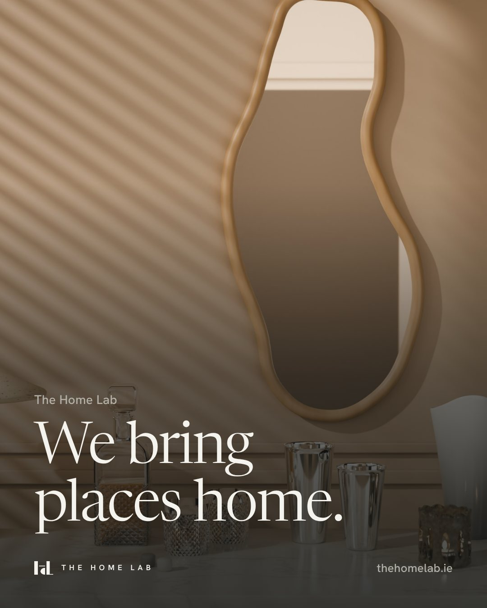 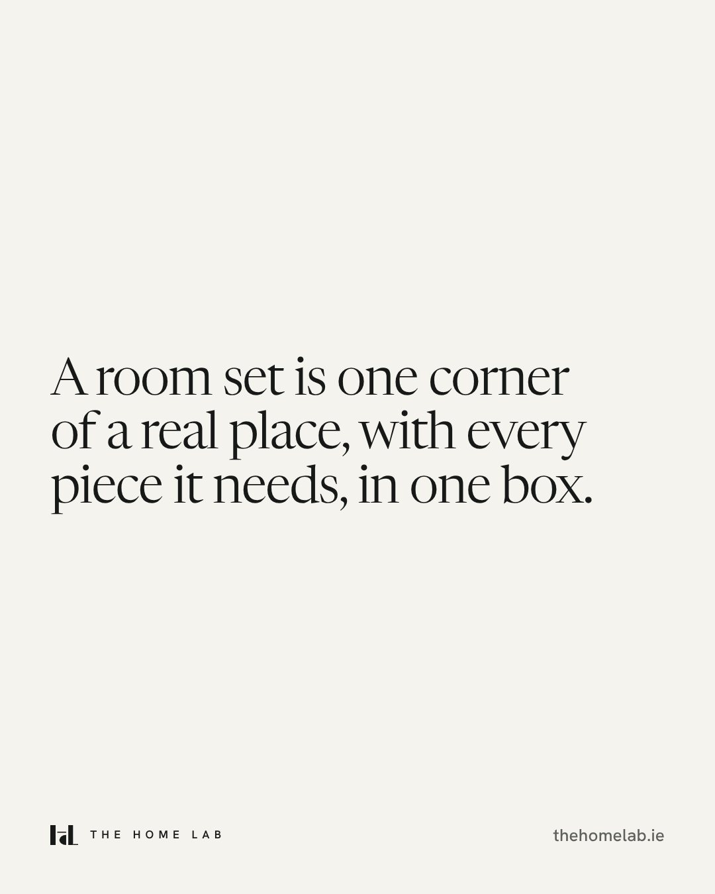 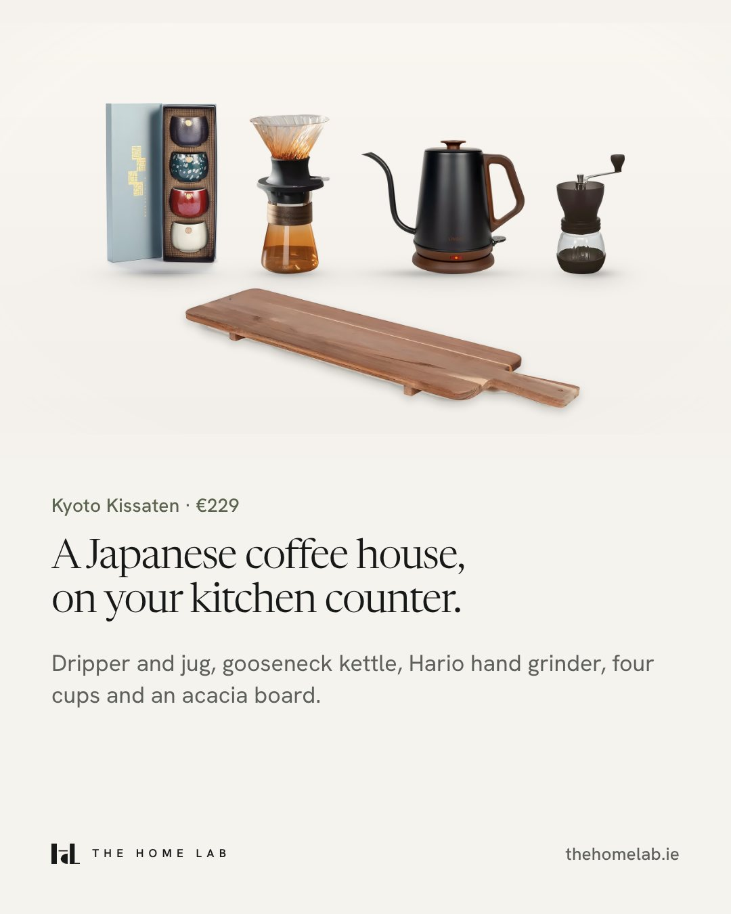   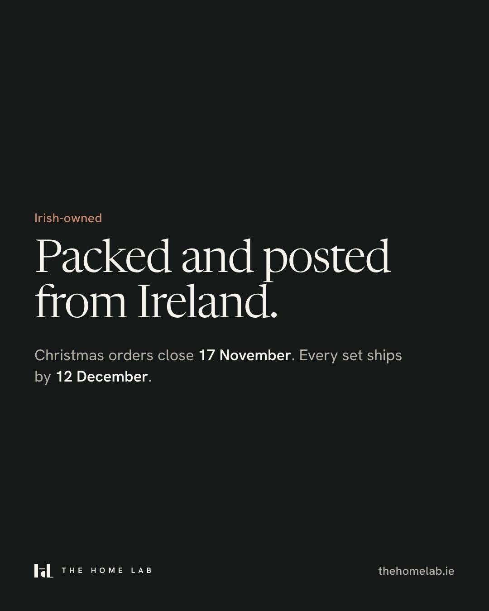</p>

| | |
| --- | --- |
| **Post** | Fri, 6 Nov 2026, 08:00 Irish time |
| **Where** | Instagram, Facebook |
| **Pillar** | Brand |
| **Set** | All |
| **Links to** | `/about` |
| **Creative** | [slide-01.jpg](creatives/post-01/slide-01.jpg), [slide-02.jpg](creatives/post-01/slide-02.jpg), [slide-03.jpg](creatives/post-01/slide-03.jpg), [slide-04.jpg](creatives/post-01/slide-04.jpg), [slide-05.jpg](creatives/post-01/slide-05.jpg), [slide-06.jpg](creatives/post-01/slide-06.jpg) |
| **Paid** | Yes. Awareness ad to Irish home and gifting interests, 6–17 Nov. |

**Headline:** We bring places home.

**On the creative, slide by slide:**

1. The Home Lab / We bring places home.
2. A room set is one corner of a real place, with every piece it needs, in one box.
3. Kyoto Kissaten · €229 / A Japanese coffee house, on your kitchen counter. / Dripper and jug, gooseneck kettle, Hario hand grinder, four cups and an acacia board.
4. The Milanese · €409 / An evening drink in a Milan apartment.
5. Riad Corner · opening in the new year / A tea corner in a Marrakech riad.
6. Irish-owned / Packed and posted from Ireland. / Christmas orders close 17 November. Every set ships by 12 December.

**Caption:**

```text
The Home Lab makes room sets. Each one recreates a corner of a real place and puts every piece it needs into one box.

Kyoto Kissaten is a Japanese coffee house on your kitchen counter: glass dripper and jug, gooseneck kettle, Hario hand grinder, four handleless cups and an acacia board. €229.

The Milanese is an evening drinks corner from a Milan apartment: crystal decanter and glasses, Boston shaker, travertine lamp, wavy mirror, glass vase and candle holders. €409.

Riad Corner, a Moroccan tea corner, opens in the new year.

Irish-owned, packed and posted from Ireland. Christmas orders close 17 November.

#irishinteriors #shopirish #irishhomes #interiorstyling #giftideas
```

**Alt text:** The Milanese set on a marble console under a wavy pine mirror, with the words: We bring places home.

**How it is made:** Launch carousel. Opens on the real photo of The Milanese, then one slide per set, then the Christmas dates. All product photos are the supplier photos of the exact pieces; Riad Corner has no product photos yet, so its slide uses the brand pattern.

<a id="post-02"></a>
### 02 · Sat, 7 Nov · Reel · Everything for pour-over coffee, in one box.

<p>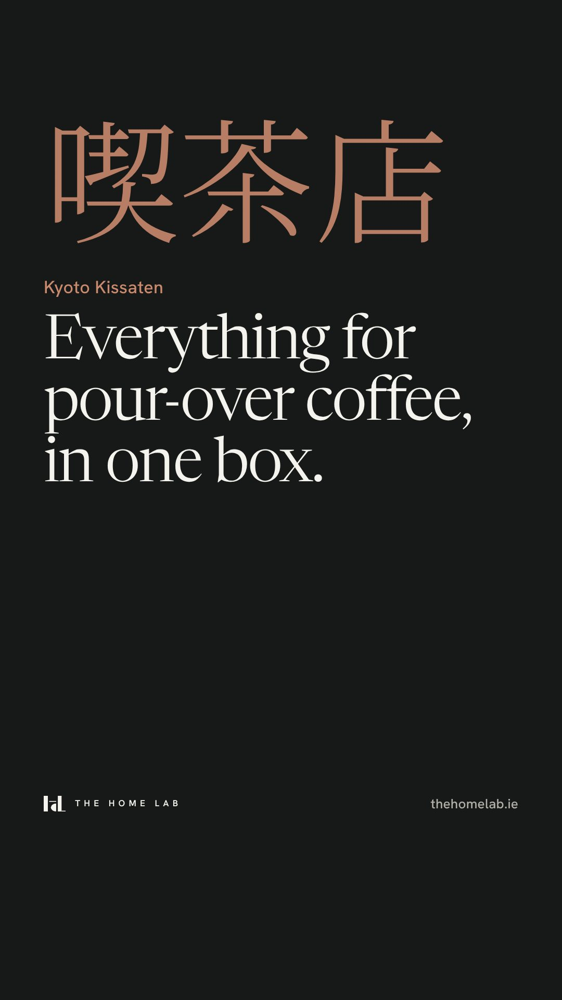 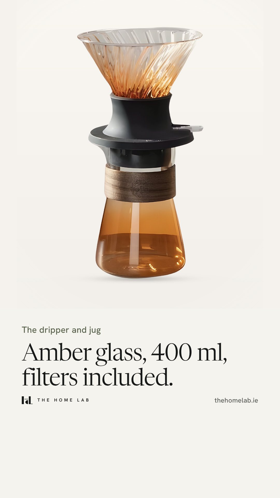 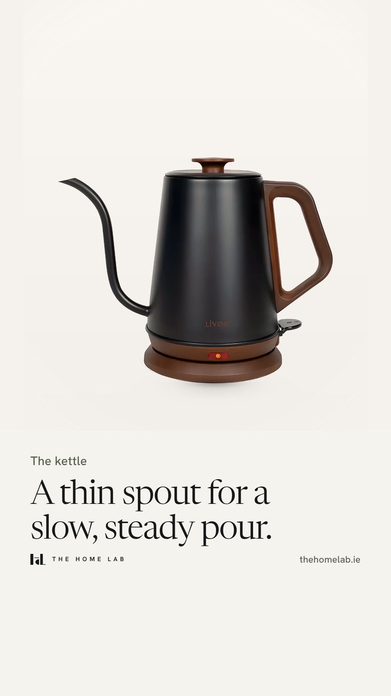 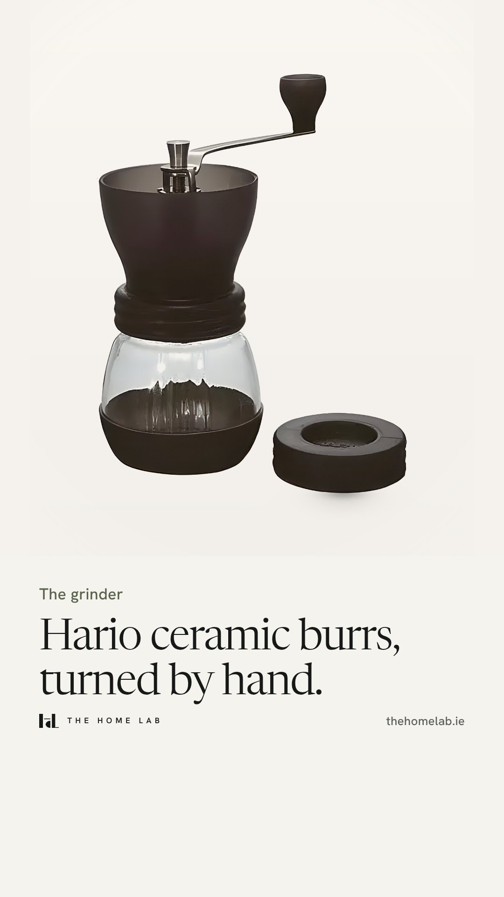 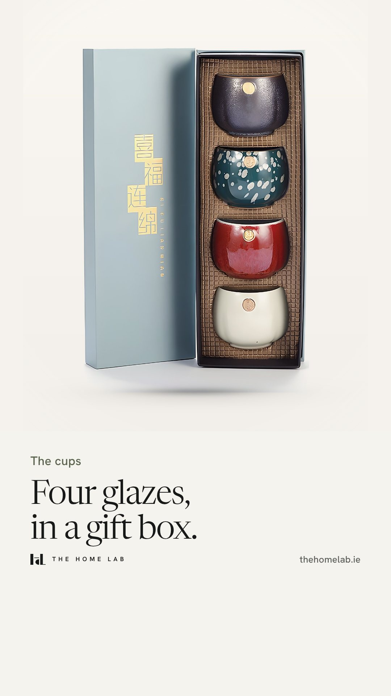 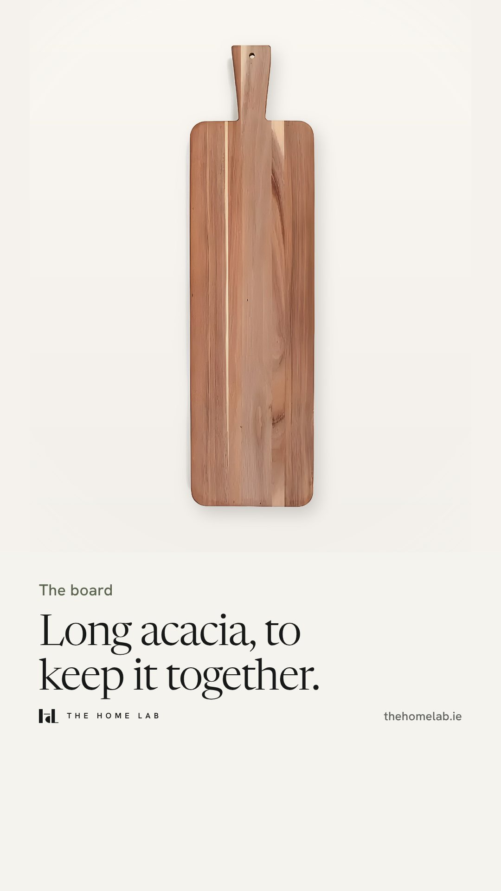 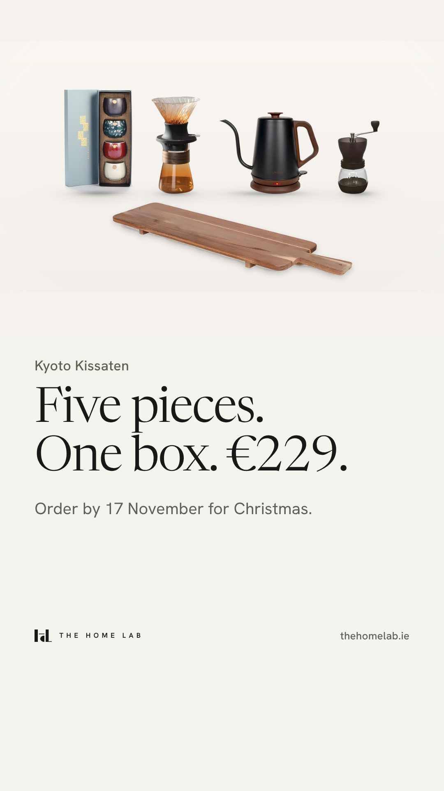</p>

| | |
| --- | --- |
| **Post** | Sat, 7 Nov 2026, 09:00 Irish time |
| **Where** | Instagram Reels, Facebook Reels, TikTok |
| **Pillar** | Product truth |
| **Set** | Kyoto Kissaten |
| **Links to** | `/sets/kyoto-kissaten` |
| **Creative** | [frame-01.jpg](creatives/post-02/frame-01.jpg), [frame-02.jpg](creatives/post-02/frame-02.jpg), [frame-03.jpg](creatives/post-02/frame-03.jpg), [frame-04.jpg](creatives/post-02/frame-04.jpg), [frame-05.jpg](creatives/post-02/frame-05.jpg), [frame-06.jpg](creatives/post-02/frame-06.jpg), [frame-07.jpg](creatives/post-02/frame-07.jpg), [reel.mp4](creatives/post-02/reel.mp4) |
| **Audio** | Soft, warm instrumental (piano or lo-fi) from the Instagram/TikTok commercial music library. No voiceover. |
| **Paid** | Yes. Lead creative for the Kyoto Kissaten sales campaign. |

**Headline:** Everything for pour-over coffee, in one box.

**On the creative, frame by frame:**

1. Kyoto Kissaten / Everything for pour-over coffee, in one box.
2. The dripper and jug / Amber glass, 400 ml, filters included.
3. The kettle / A thin spout for a slow, steady pour.
4. The grinder / Hario ceramic burrs, turned by hand.
5. The cups / Four glazes, in a gift box.
6. The board / Long acacia, to keep it together.
7. Kyoto Kissaten / Five pieces. One box. €229. / Order by 17 November for Christmas.

**Caption:**

```text
A kissaten is a Japanese coffee house where coffee is poured by hand, one cup at a time. This is the whole counter in one box:

The dripper and jug: amber glass, 400 ml, with a pack of filters.
The kettle: electric, with a gooseneck spout for a slow, steady pour.
The grinder: Hario, ceramic burrs.
The cups: four, handleless, each in a different glaze.
The board: long acacia, to keep it all together.

€229 for the set, €50 less than the pieces bought one by one. Just add beans.
Christmas orders close 17 November.

#pourover #coffeeathome #kissaten #coffeeireland #shopirish
```

**Alt text:** Each piece of the Kyoto Kissaten set in turn: amber glass dripper, black gooseneck kettle, Hario hand grinder, four glazed cups, acacia board, then all five together.

**How it is made:** Seven still frames, one per piece, built into a silent MP4 with a slow push-in and crossfades (reel.mp4). Add music in the app before posting. Upgrade option: cut in 2–3 seconds of licensed stock footage of a pour-over being made (search "pour over coffee slow motion") between frames 1 and 2, labelled as a scene, not the product.

<a id="post-03"></a>
### 03 · Sun, 8 Nov · Static · Turn the main light off. Pour a drink.

<p>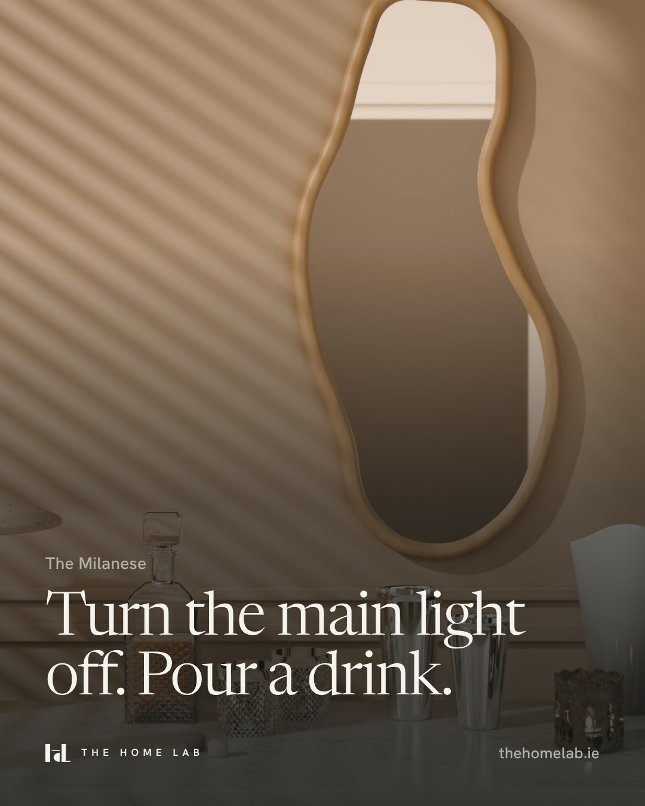</p>

| | |
| --- | --- |
| **Post** | Sun, 8 Nov 2026, 20:00 Irish time |
| **Where** | Instagram, Facebook, Pinterest |
| **Pillar** | Place and mood |
| **Set** | The Milanese |
| **Links to** | `/sets/the-milanese` |
| **Creative** | [slide-01.jpg](creatives/post-03/slide-01.jpg) |
| **Story version** | [story-01.jpg](creatives/post-03/story-01.jpg) |
| **Paid** | Yes. Lead image for The Milanese sales campaign (Facebook and Instagram, 25+). |

**Headline:** Turn the main light off. Pour a drink.

**On the creative, slide by slide:**

1. The Milanese / Turn the main light off. Pour a drink.

**Caption:**

```text
In Milan, the evening starts at a console: a decanter, a few good glasses, a stone lamp and candles, with the ceiling light off.

The Milanese is that corner, in one box. A cut-crystal decanter with four glasses, a two-tin Boston shaker, a travertine lamp, a wavy pine mirror, a blown glass vase and two candle holders. You add the drinks.

€409, which is €75 less than the six pieces bought separately. Order by 17 November for Christmas.

#homebar #consolestyling #travertine #aperitivo #irishinteriors
```

**Alt text:** The Milanese set on a marble console in lamplight: travertine lamp, crystal decanter and glasses, steel shaker tins, glass vase, candle holders and a wavy pine mirror.

**How it is made:** The real set photo, cropped to 4:5, with the line from the set’s own guide. Post at 8pm, when the scene is happening in people’s own homes. Story version included.

<a id="post-04"></a>
### 04 · Mon, 9 Nov · Carousel · What is a kissaten?

<p> 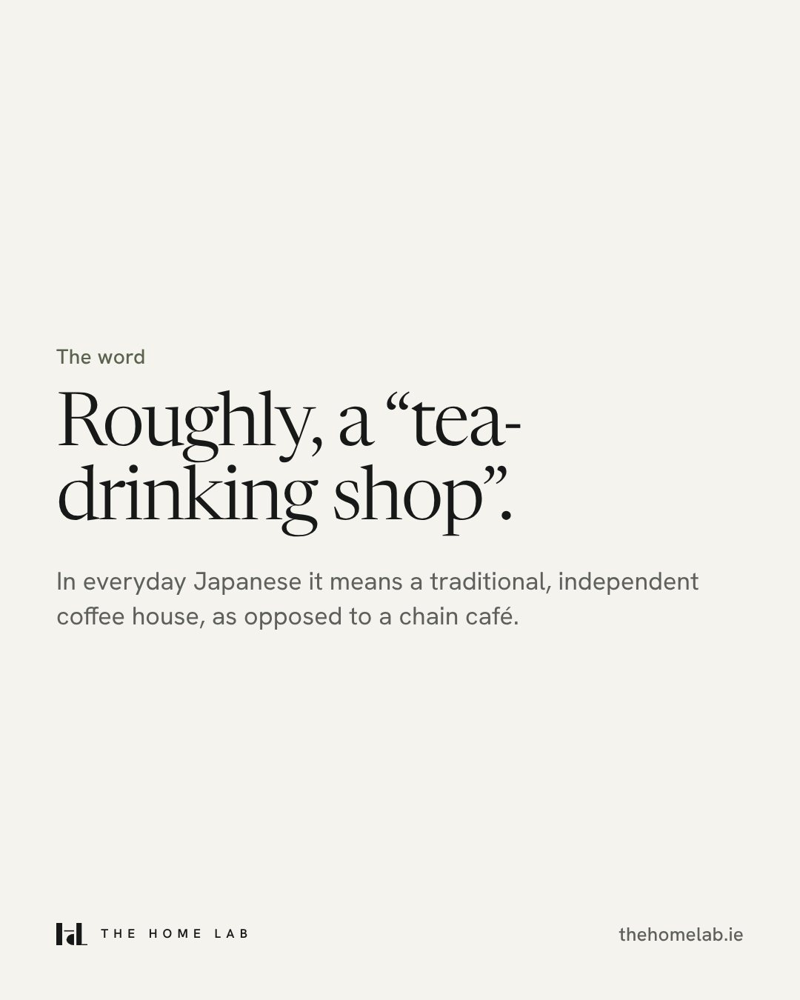 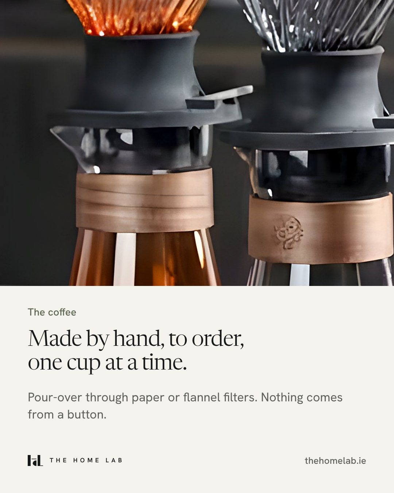 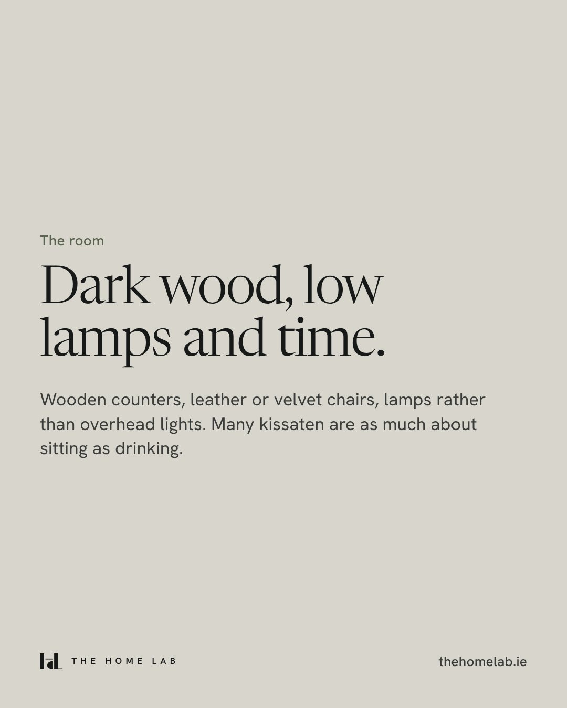 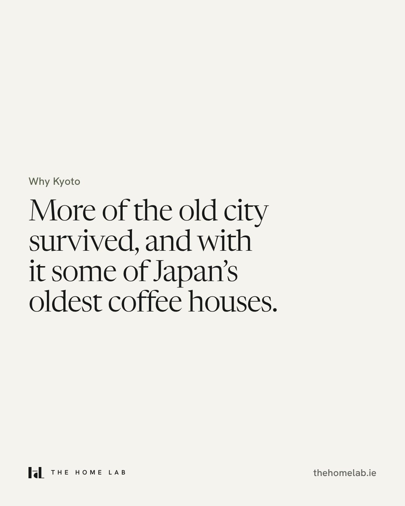 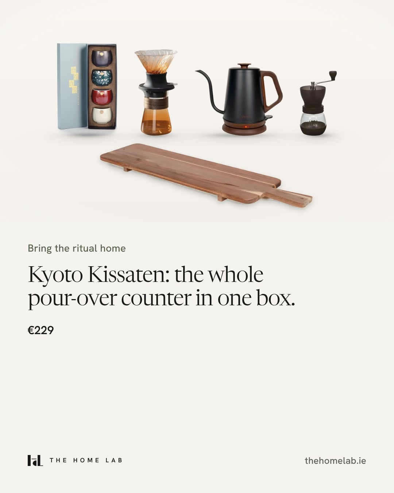</p>

| | |
| --- | --- |
| **Post** | Mon, 9 Nov 2026, 12:30 Irish time |
| **Where** | Instagram, Facebook |
| **Pillar** | Place and culture |
| **Set** | Kyoto Kissaten |
| **Links to** | `/journal/what-is-a-kissaten` |
| **Creative** | [slide-01.jpg](creatives/post-04/slide-01.jpg), [slide-02.jpg](creatives/post-04/slide-02.jpg), [slide-03.jpg](creatives/post-04/slide-03.jpg), [slide-04.jpg](creatives/post-04/slide-04.jpg), [slide-05.jpg](creatives/post-04/slide-05.jpg), [slide-06.jpg](creatives/post-04/slide-06.jpg) |
| **Paid** | Optional. Good as a low-cost engagement ad to coffee interests; builds a warm audience for retargeting. |

**Headline:** What is a kissaten?

**On the creative, slide by slide:**

1. Kyoto / What is a kissaten?
2. The word / Roughly, a “tea-drinking shop”. / In everyday Japanese it means a traditional, independent coffee house, as opposed to a chain café.
3. The coffee / Made by hand, to order, one cup at a time. / Pour-over through paper or flannel filters. Nothing comes from a button.
4. The room / Dark wood, low lamps and time. / Wooden counters, leather or velvet chairs, lamps rather than overhead lights. Many kissaten are as much about sitting as drinking.
5. Why Kyoto / More of the old city survived, and with it some of Japan’s oldest coffee houses.
6. Bring the ritual home / Kyoto Kissaten: the whole pour-over counter in one box.

**Caption:**

```text
Kissaten (喫茶店) translates roughly as "tea-drinking shop", but in everyday Japanese it means a traditional, independent coffee house.

They are usually small, often family-run, with dark wood, low lamps and coffee made by hand, to order, one cup at a time. Nobody hurries you.

Kyoto escaped the worst of the wartime bombing, so some of Japan's oldest coffee houses still run there.

The full story is in our Journal: "What is a kissaten?" Link in bio.

#pourover #coffeeathome #kissaten #kyoto #japaneseculture
```

**Alt text:** The word kissaten in Japanese characters, with the question: What is a kissaten?

**How it is made:** An explainer carousel from the Journal article. Mostly type, so it is quick to read and saves well. The kanji is set in Noto Serif JP.

<a id="post-05"></a>
### 05 · Tue, 10 Nov · Carousel · Five pieces. €279 separately. €229 as a set.

<p>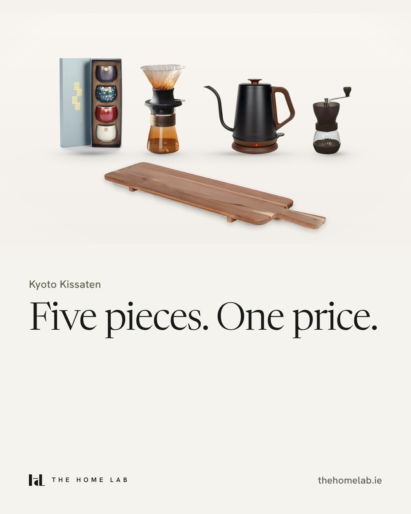 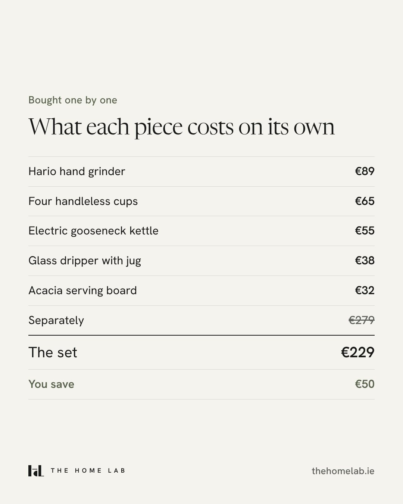 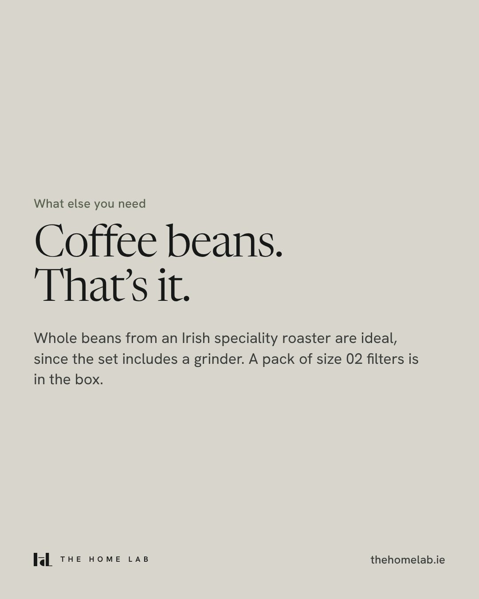 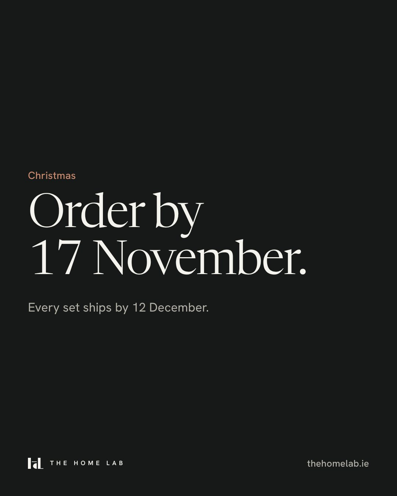</p>

| | |
| --- | --- |
| **Post** | Tue, 10 Nov 2026, 08:00 Irish time |
| **Where** | Instagram, Facebook |
| **Pillar** | Product truth |
| **Set** | Kyoto Kissaten |
| **Links to** | `/sets/kyoto-kissaten` |
| **Creative** | [slide-01.jpg](creatives/post-05/slide-01.jpg), [slide-02.jpg](creatives/post-05/slide-02.jpg), [slide-03.jpg](creatives/post-05/slide-03.jpg), [slide-04.jpg](creatives/post-05/slide-04.jpg) |
| **Paid** | Yes. Retargeting ad for people who viewed the Kyoto set page but did not buy. |

**Headline:** Five pieces. €279 separately. €229 as a set.

**On the creative, slide by slide:**

1. Kyoto Kissaten / Five pieces. One price.
2. Bought one by one / What each piece costs on its own
3. What else you need / Coffee beans. That’s it. / Whole beans from an Irish speciality roaster are ideal, since the set includes a grinder. A pack of size 02 filters is in the box.
4. Christmas / Order by 17 November. / Every set ships by 12 December.

**Caption:**

```text
What's in Kyoto Kissaten, and what each piece costs on its own:

Hario hand grinder €89
Four handleless cups €65
Electric gooseneck kettle €55
Glass dripper with jug €38
Acacia serving board €32

That's €279 one by one. The set is €229.

The only thing you need to add is coffee. Whole beans from an Irish roaster are ideal, since the grinder is in the box.

#pourover #coffeeathome #kissaten #coffeegifts #shopirish
```

**Alt text:** Everything in the Kyoto Kissaten set, with the line: Five pieces. One price.

**How it is made:** The price arithmetic, shown plainly. Each piece is sold on its own at these prices, so the comparison is real (see the advertising plan for the price-claim rules).

<a id="post-06"></a>
### 06 · Wed, 11 Nov · Reel · From a bare console to Milan, in six pieces.

<p>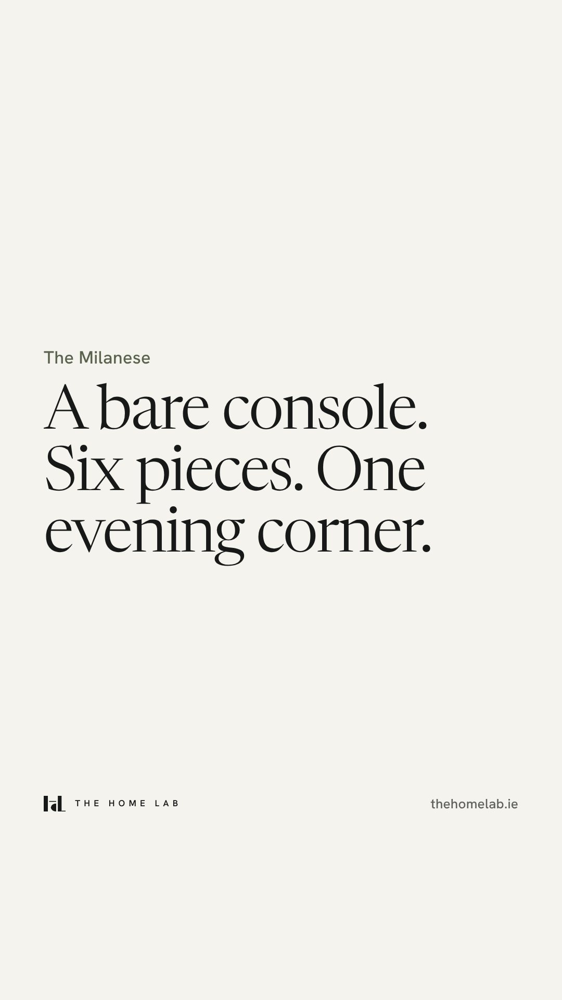 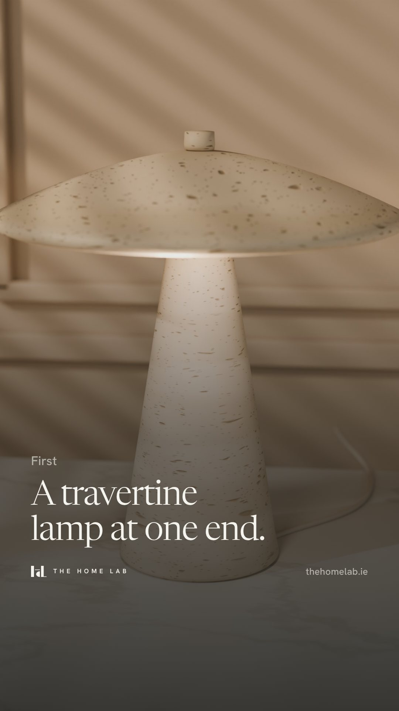 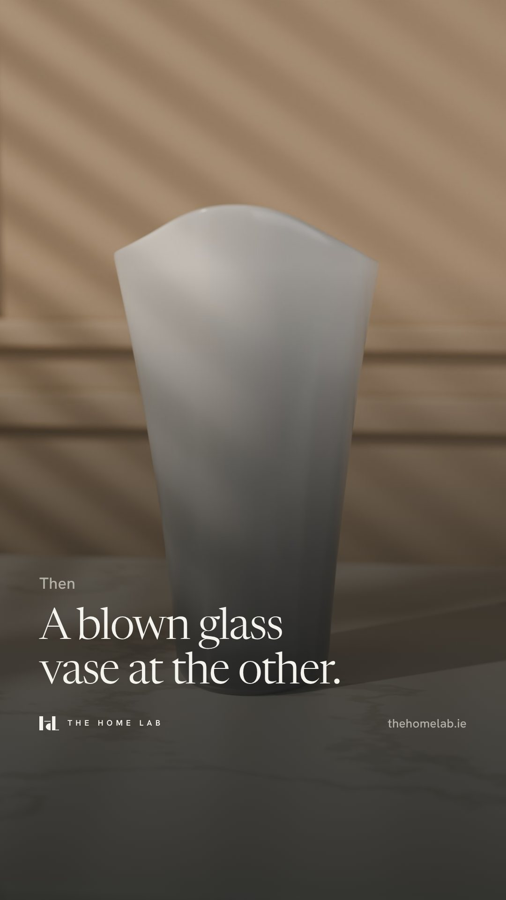 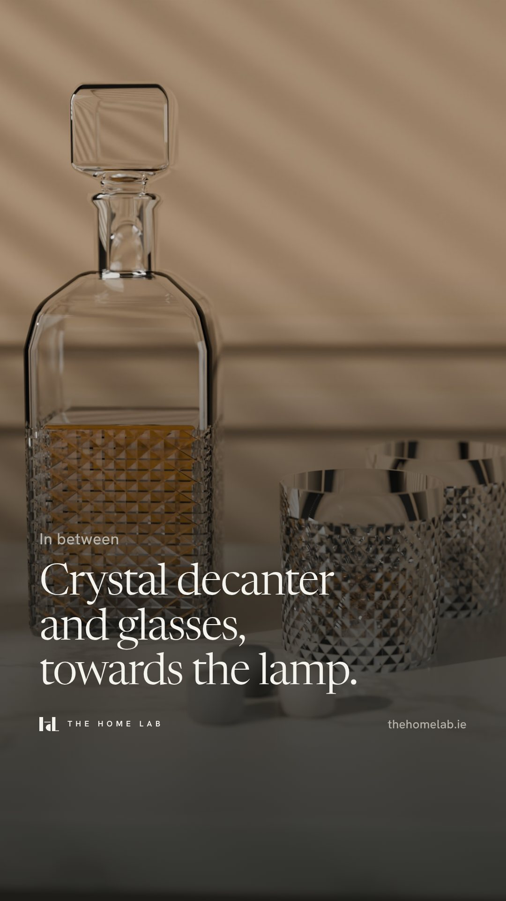 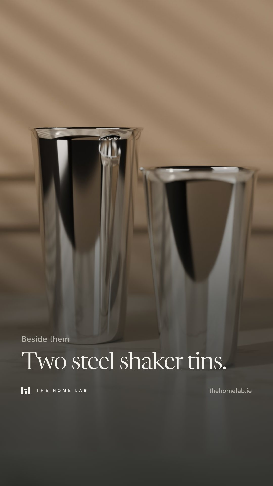 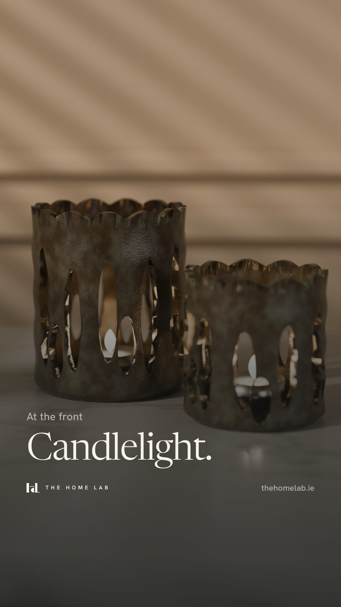 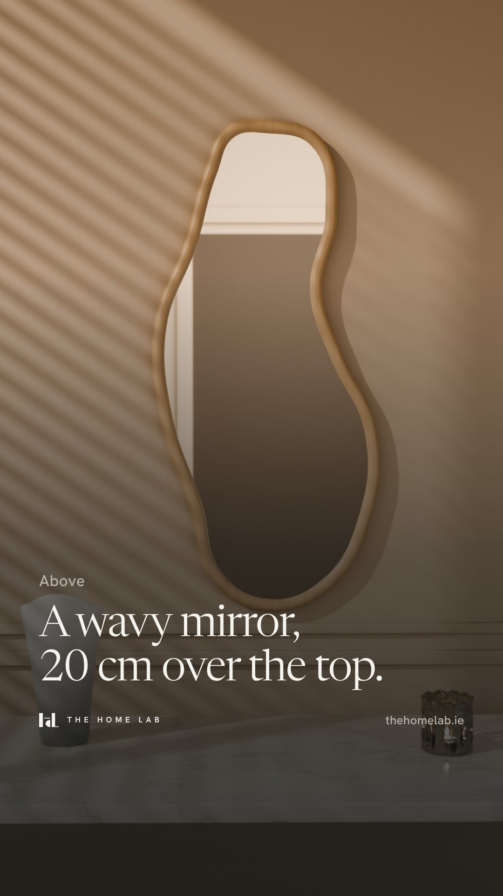 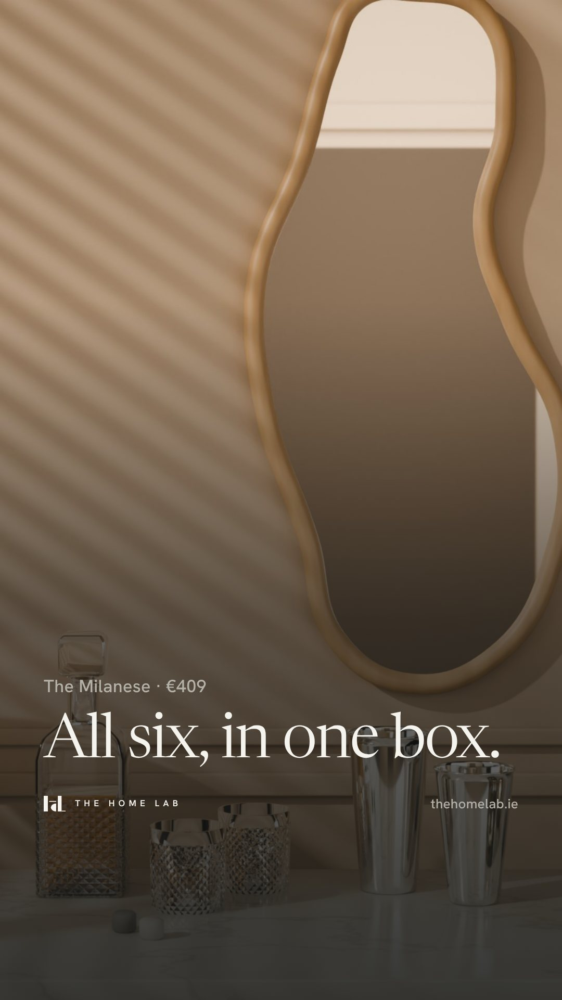</p>

| | |
| --- | --- |
| **Post** | Wed, 11 Nov 2026, 19:30 Irish time |
| **Where** | Instagram Reels, Facebook Reels, TikTok |
| **Pillar** | Styling |
| **Set** | The Milanese |
| **Links to** | `/sets/the-milanese` |
| **Creative** | [frame-01.jpg](creatives/post-06/frame-01.jpg), [frame-02.jpg](creatives/post-06/frame-02.jpg), [frame-03.jpg](creatives/post-06/frame-03.jpg), [frame-04.jpg](creatives/post-06/frame-04.jpg), [frame-05.jpg](creatives/post-06/frame-05.jpg), [frame-06.jpg](creatives/post-06/frame-06.jpg), [frame-07.jpg](creatives/post-06/frame-07.jpg), [frame-08.jpg](creatives/post-06/frame-08.jpg), [reel.mp4](creatives/post-06/reel.mp4) |
| **Audio** | Slow Italian-feeling instrumental or soft jazz from the commercial library. No voiceover. |
| **Paid** | Yes. Lead video for The Milanese on Instagram and Facebook. For TikTok ads use the version without the decanter frame (see advertising plan). |

**Headline:** From a bare console to Milan, in six pieces.

**On the creative, frame by frame:**

1. The Milanese / A bare console. Six pieces. One evening corner.
2. First / A travertine lamp at one end.
3. Then / A blown glass vase at the other.
4. In between / Crystal decanter and glasses, towards the lamp.
5. Beside them / Two steel shaker tins.
6. At the front / Candlelight.
7. Above / A wavy mirror, 20 cm over the top.
8. The Milanese · €409 / All six, in one box.

**Caption:**

```text
A bare console is one of the hardest surfaces in a home to get right. Here's how six pieces turn one into a Milan drinks corner:

Lamp at one end. Vase at the other. Decanter and glasses towards the lamp. Shaker beside them. Candles at the front. Mirror centred above.

The Milanese is all six, in one box. €409.

#homebar #consolestyling #travertine #homedecorideas #irishinteriors
```

**Alt text:** The pieces of The Milanese appear one at a time on a marble console: travertine lamp, glass vase, crystal decanter, steel shaker, candle holders and the wavy mirror, then the finished corner.

**How it is made:** Builds the console piece by piece, in the order of the set-up guide, then lands on the finished set photo. All frames are supplier photos of the actual pieces, all shot in the same room, so the sequence reads as one place.

<a id="post-07"></a>
### 07 · Thu, 12 Nov · Carousel · Gifts for coffee lovers, by budget.

<p>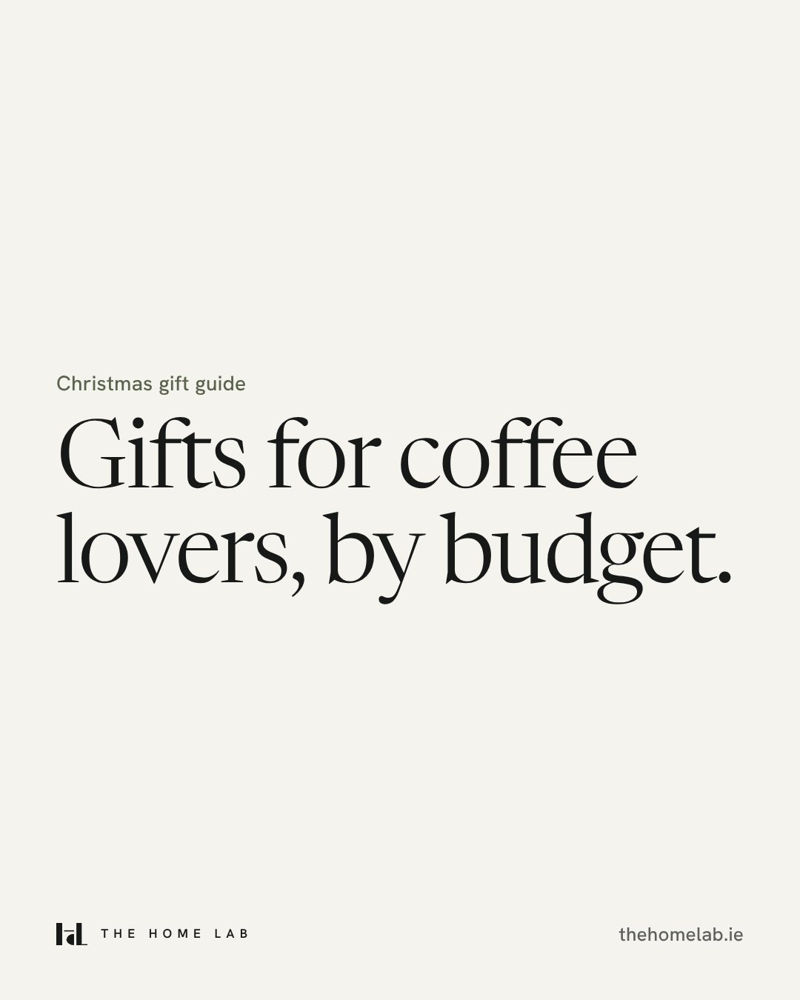 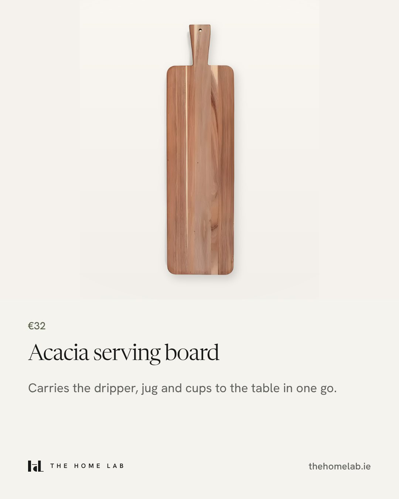 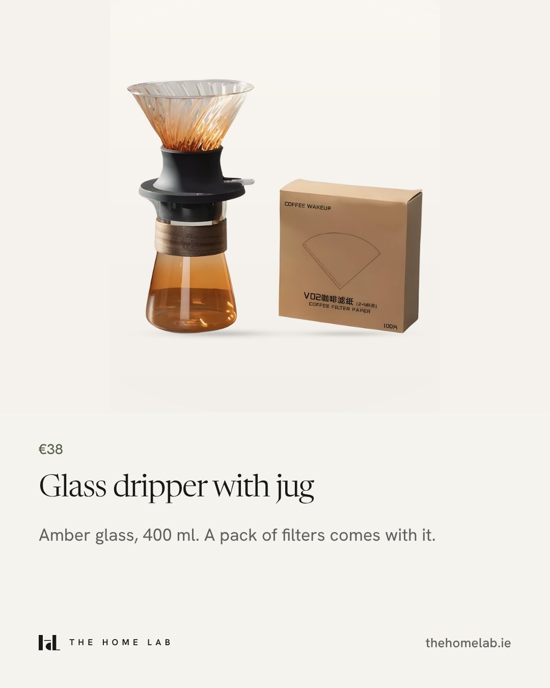 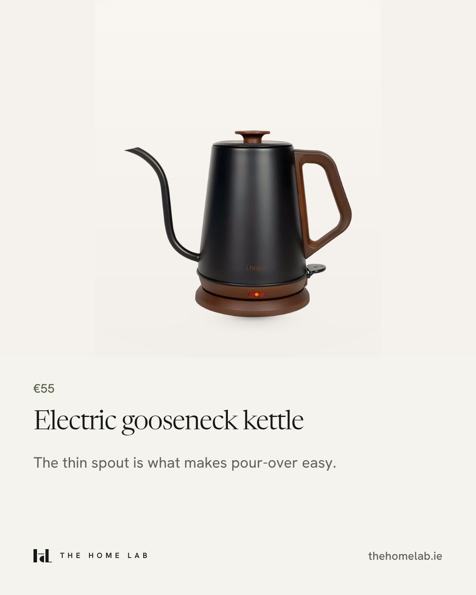 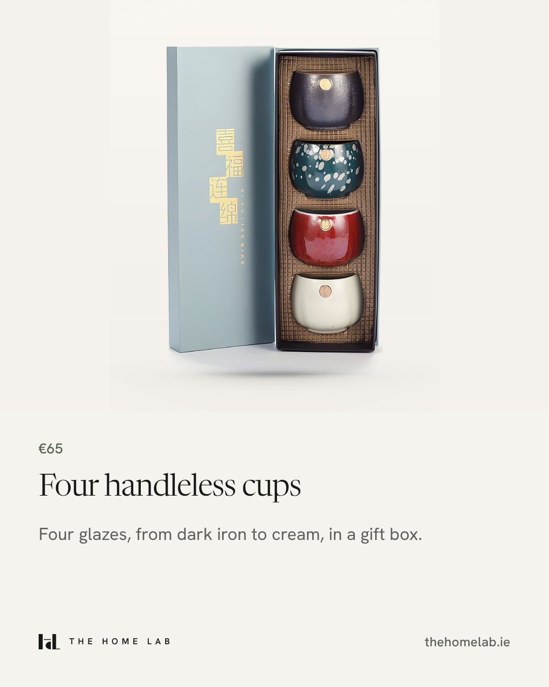 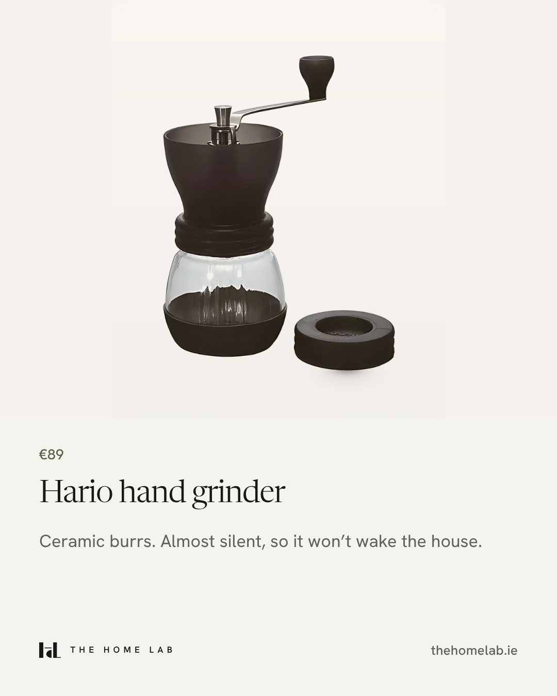 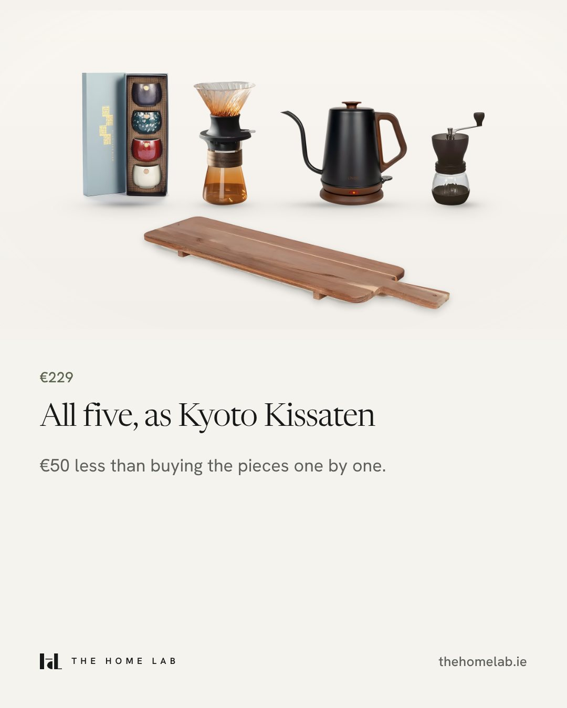</p>

| | |
| --- | --- |
| **Post** | Thu, 12 Nov 2026, 12:30 Irish time |
| **Where** | Instagram, Facebook |
| **Pillar** | Gifting |
| **Set** | Kyoto Kissaten |
| **Links to** | `/journal/gifts-for-coffee-lovers-ireland` |
| **Creative** | [slide-01.jpg](creatives/post-07/slide-01.jpg), [slide-02.jpg](creatives/post-07/slide-02.jpg), [slide-03.jpg](creatives/post-07/slide-03.jpg), [slide-04.jpg](creatives/post-07/slide-04.jpg), [slide-05.jpg](creatives/post-07/slide-05.jpg), [slide-06.jpg](creatives/post-07/slide-06.jpg), [slide-07.jpg](creatives/post-07/slide-07.jpg) |
| **Paid** | Yes. Gift-intent ad (Facebook and Instagram, 30+, coffee and gift interests). Each slide links to its product as a catalogue carousel ad. |

**Headline:** Gifts for coffee lovers, by budget.

**On the creative, slide by slide:**

1. Christmas gift guide / Gifts for coffee lovers, by budget.
2. €32 / Acacia serving board / Carries the dripper, jug and cups to the table in one go.
3. €38 / Glass dripper with jug / Amber glass, 400 ml. A pack of filters comes with it.
4. €55 / Electric gooseneck kettle / The thin spout is what makes pour-over easy.
5. €65 / Four handleless cups / Four glazes, from dark iron to cream, in a gift box.
6. €89 / Hario hand grinder / Ceramic burrs. Almost silent, so it won’t wake the house.
7. €229 / All five, as Kyoto Kissaten / €50 less than buying the pieces one by one.

**Caption:**

```text
Gifts for coffee lovers, by budget. Every piece is sold on its own:

€32 Acacia serving board
€38 Glass pour-over dripper with jug (filters included)
€55 Electric gooseneck kettle
€65 Four handleless cups in a gift box
€89 Hario ceramic hand grinder
€229 All five together, as Kyoto Kissaten

Posted from Ireland, so there's nothing to pay on the doorstep. Save this for later.

#christmasgiftsireland #giftideas #coffeegifts #pourover #shopirish
```

**Alt text:** Gifts for coffee lovers by budget, from a €32 acacia board to the €229 Kyoto Kissaten set.

**How it is made:** One piece per slide, cheapest first, ending on the full set. Every price is the price of that piece on its own in the shop.

<a id="post-08"></a>
### 08 · Thu, 12 Nov · Static · Five days left to order for Christmas.

<p>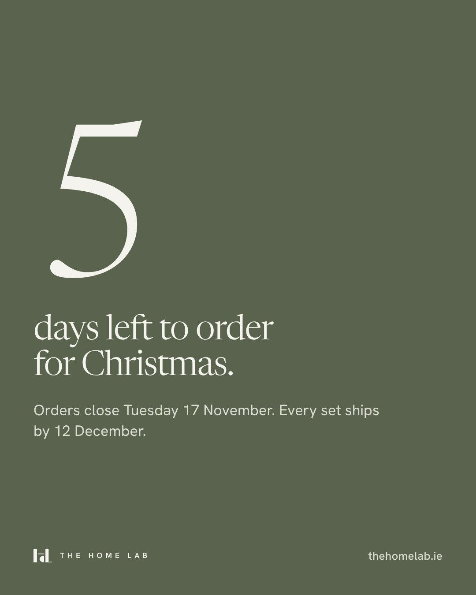</p>

| | |
| --- | --- |
| **Post** | Thu, 12 Nov 2026, 19:00 Irish time |
| **Where** | Instagram Stories, Facebook |
| **Pillar** | Deadline |
| **Set** | All |
| **Links to** | `/` |
| **Creative** | [slide-01.jpg](creatives/post-08/slide-01.jpg) |
| **Story version** | [story-01.jpg](creatives/post-08/story-01.jpg) |
| **Paid** | Yes. Short deadline ad to everyone who engaged or visited in the last 30 days. |

**Headline:** Five days left to order for Christmas.

**On the creative, slide by slide:**

1. days left to order for Christmas. / Orders close Tuesday 17 November. Every set ships by 12 December.

**Caption:**

```text
Five days left. Christmas orders close on Tuesday 17 November, and every set in the batch ships by 12 December.

Sets are made up in batches: when the batch closes we gather every piece, check it and pack each set in one box, here in Ireland.

#christmasgiftsireland #giftideas #shopirish
```

**Alt text:** The number 5, with the words: days left to order for Christmas.

**How it is made:** Countdown card. Story version for Instagram Stories with a link sticker to the homepage; feed version for Facebook.

<a id="post-09"></a>
### 09 · Thu, 12 Nov · Pin · Japanese pour-over coffee set: everything in one box

<p>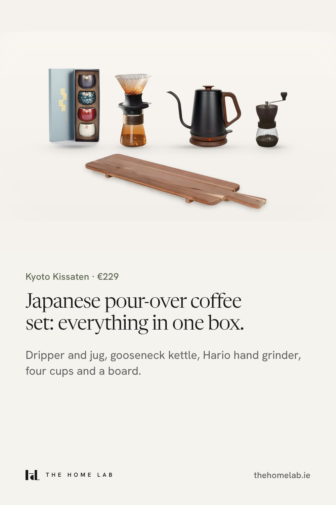</p>

| | |
| --- | --- |
| **Post** | Thu, 12 Nov 2026, 21:00 Irish time |
| **Where** | Pinterest |
| **Pillar** | Search and saves |
| **Set** | Kyoto Kissaten |
| **Links to** | `/sets/kyoto-kissaten` |
| **Creative** | [slide-01.jpg](creatives/post-09/slide-01.jpg) |
| **Pinterest board** | Coffee corner ideas |
| **Paid** | Yes. Pinterest consideration campaign, keywords: pour over coffee set, coffee gifts, coffee corner. |

**Headline:** Japanese pour-over coffee set: everything in one box

**Pin title:** Japanese pour-over coffee set: dripper, gooseneck kettle, Hario grinder, cups and board

**On the creative, slide by slide:**

1. Kyoto Kissaten · €229 / Japanese pour-over coffee set: everything in one box. / Dripper and jug, gooseneck kettle, Hario hand grinder, four cups and a board.

**Caption:**

```text
A complete Japanese pour-over coffee setup in one box: amber glass dripper and jug with filters, electric gooseneck kettle, Hario ceramic hand grinder, four handleless cups and an acacia serving board. Pour-over coffee at home with nothing else to buy apart from beans. A coffee gift for Christmas, posted from Ireland.
```

**Alt text:** Everything in the Kyoto Kissaten pour-over coffee set laid out on a pale background.

**How it is made:** Pinterest pin, 2:3. Title and description are written for Pinterest search.

<a id="post-10"></a>
### 10 · Fri, 13 Nov · Carousel · How to brew pour-over in six steps.

<p> 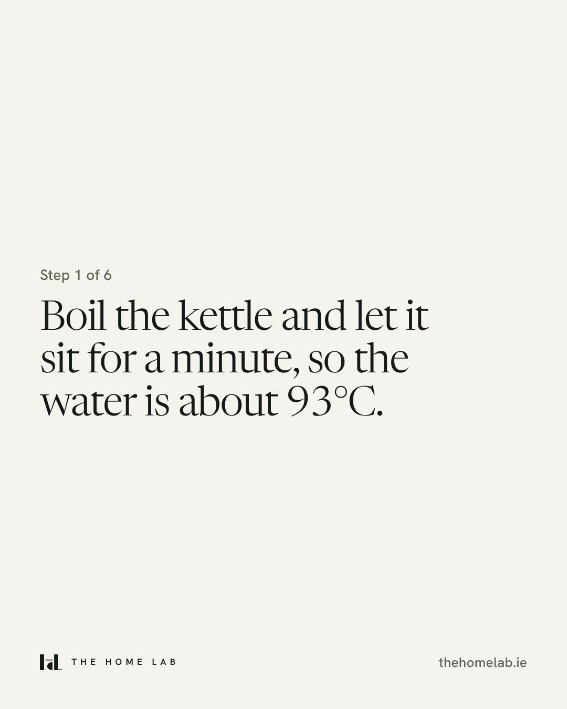 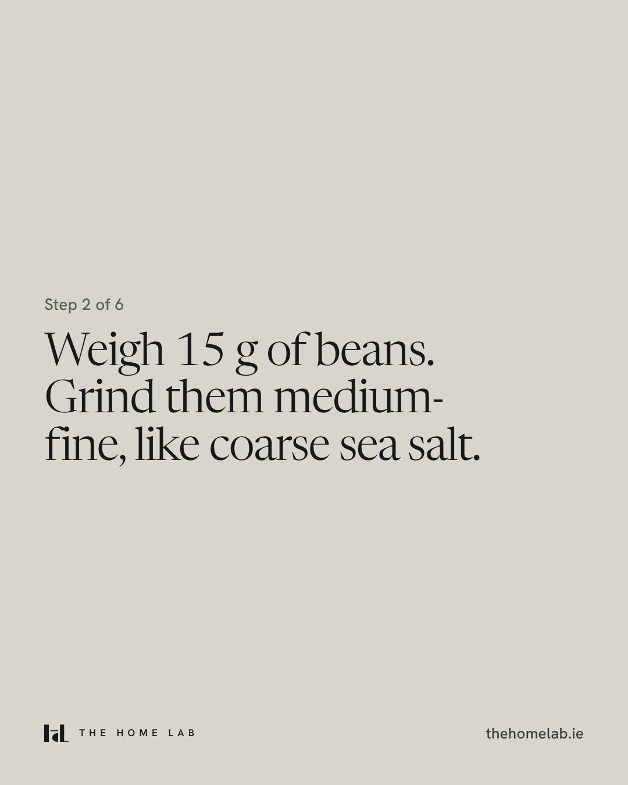 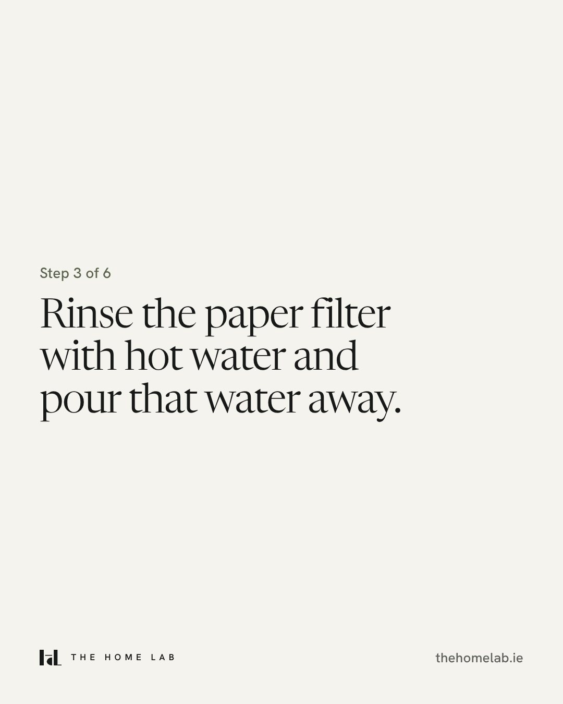 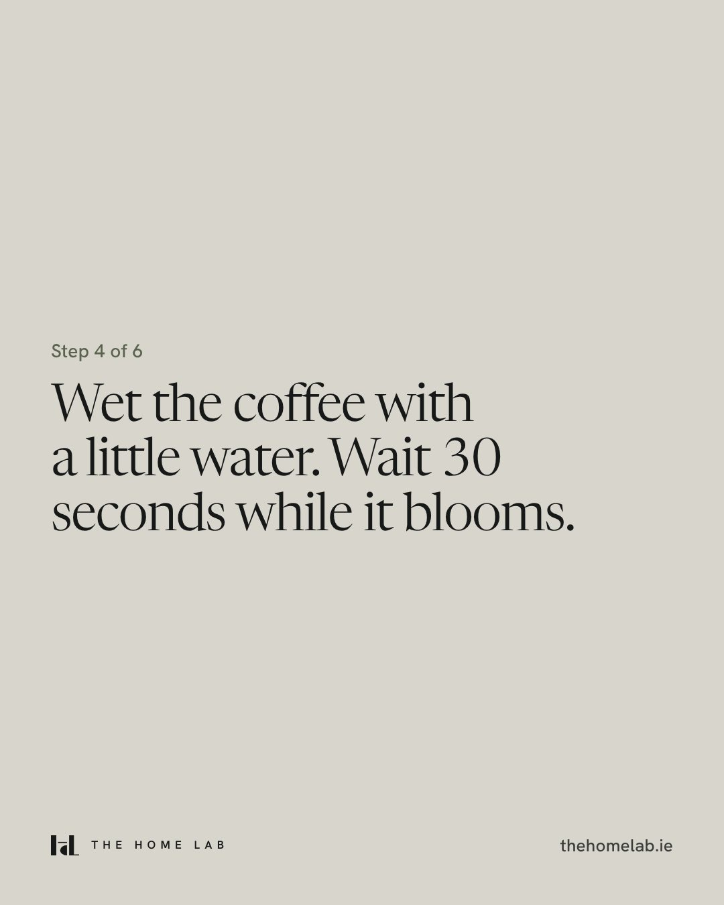 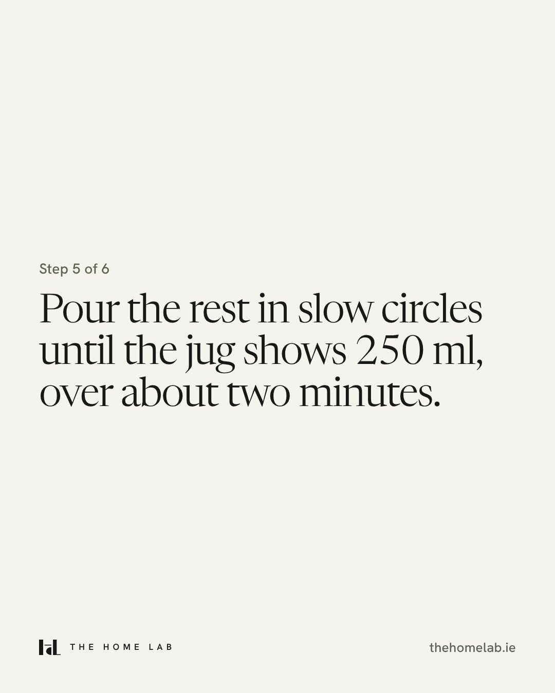 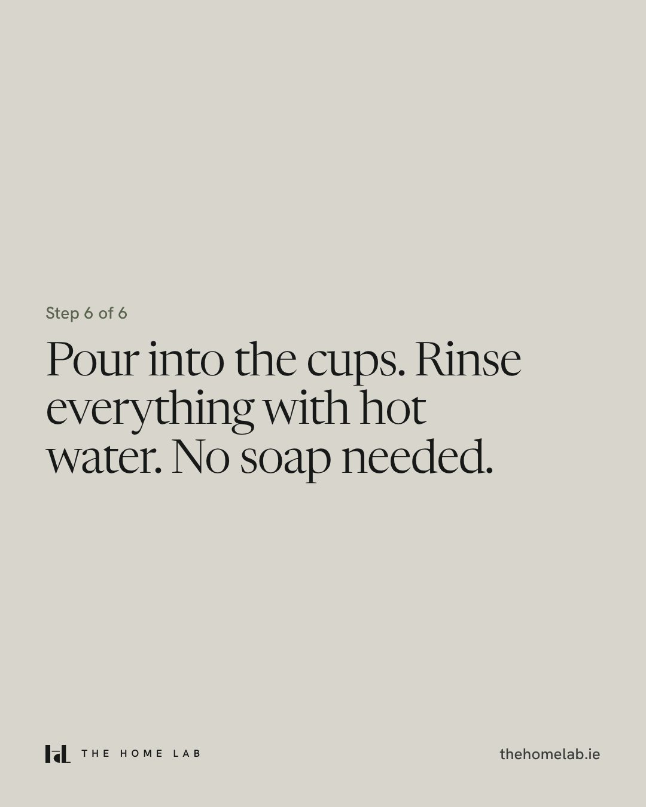 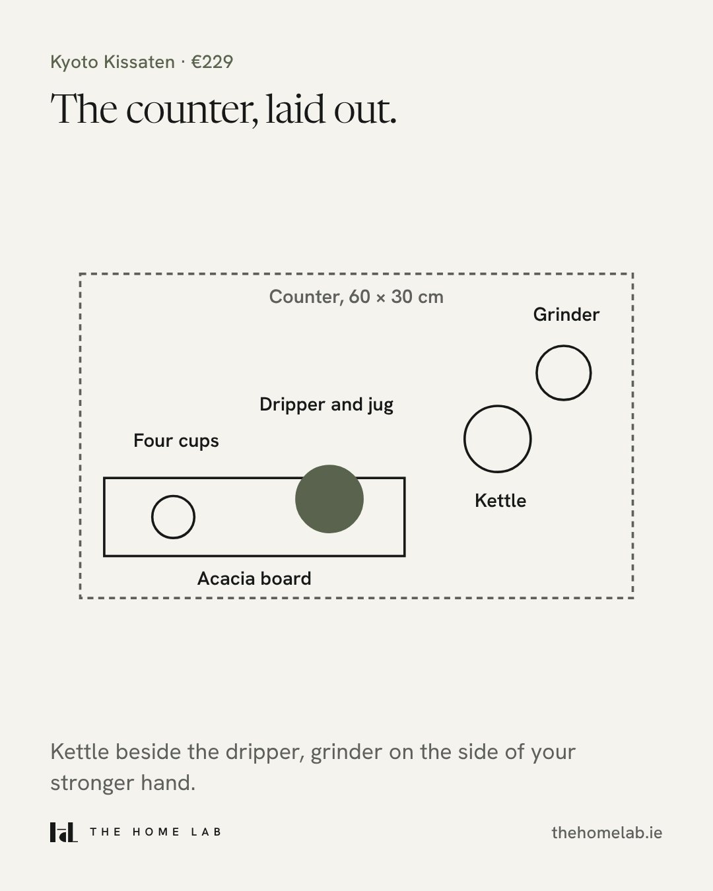</p>

| | |
| --- | --- |
| **Post** | Fri, 13 Nov 2026, 08:00 Irish time |
| **Where** | Instagram, Facebook, Pinterest |
| **Pillar** | Ritual and how-to |
| **Set** | Kyoto Kissaten |
| **Links to** | `/journal/pour-over-coffee-for-beginners` |
| **Creative** | [slide-01.jpg](creatives/post-10/slide-01.jpg), [slide-02.jpg](creatives/post-10/slide-02.jpg), [slide-03.jpg](creatives/post-10/slide-03.jpg), [slide-04.jpg](creatives/post-10/slide-04.jpg), [slide-05.jpg](creatives/post-10/slide-05.jpg), [slide-06.jpg](creatives/post-10/slide-06.jpg), [slide-07.jpg](creatives/post-10/slide-07.jpg), [slide-08.jpg](creatives/post-10/slide-08.jpg) |
| **Paid** | Optional. Strong save rate makes it a cheap engagement ad and a good Pinterest idea pin. |

**Headline:** How to brew pour-over in six steps.

**On the creative, slide by slide:**

1. Save for Christmas morning / How to brew pour-over in six steps.
2. Step 1 of 6 / Boil the kettle and let it sit for a minute, so the water is about 93°C.
3. Step 2 of 6 / Weigh 15 g of beans. Grind them medium-fine, like coarse sea salt.
4. Step 3 of 6 / Rinse the paper filter with hot water and pour that water away.
5. Step 4 of 6 / Wet the coffee with a little water. Wait 30 seconds while it blooms.
6. Step 5 of 6 / Pour the rest in slow circles until the jug shows 250 ml, over about two minutes.
7. Step 6 of 6 / Pour into the cups. Rinse everything with hot water. No soap needed.
8. Kyoto Kissaten · €229 / The counter, laid out. / Kettle beside the dripper, grinder on the side of your stronger hand.

**Caption:**

```text
How to brew pour-over coffee in six steps. Save this one for Christmas morning.

1. Boil the kettle and let it sit for a minute, so the water is about 93°C.
2. Weigh 15 g of beans and grind them medium-fine, like coarse sea salt.
3. Put a paper filter in the dripper, rinse it with hot water and pour that water away.
4. Add the coffee, wet it with a little water and wait 30 seconds while it blooms.
5. Pour the rest in slow circles until the jug shows 250 ml, over about two minutes.
6. Pour into cups. Rinse everything with hot water; the dripper needs no soap.

Our beginner's guide in the Journal goes further. Link in bio.

#pourover #coffeeathome #kissaten #coffeetips #coffeeireland
```

**Alt text:** A step-by-step guide to brewing pour-over coffee, starting with hot water being poured into a glass dripper.

**How it is made:** The brewing guide from the set page, one step per slide, so people save it. Upload the slides to Pinterest as a multi-image pin too.

<a id="post-11"></a>
### 11 · Sat, 14 Nov · Reel · The five-piece console formula.

<p> 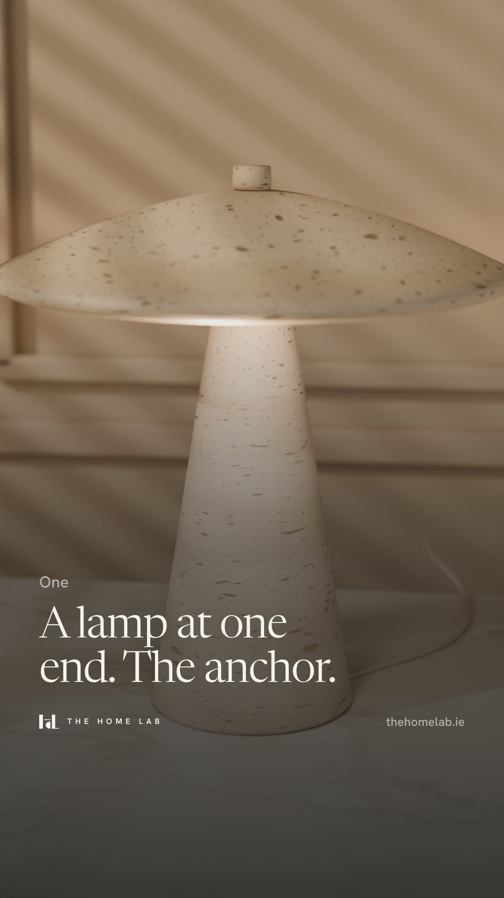 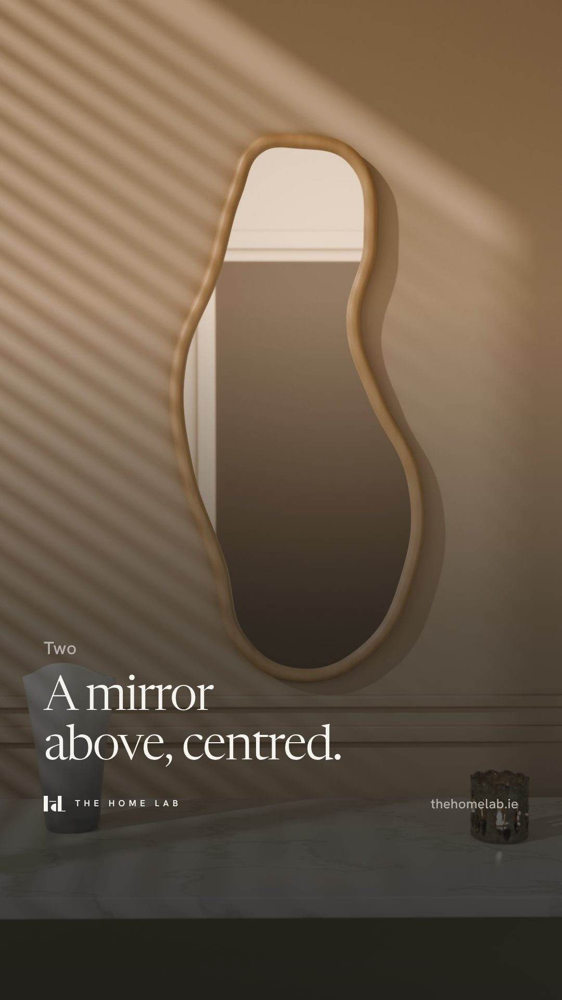 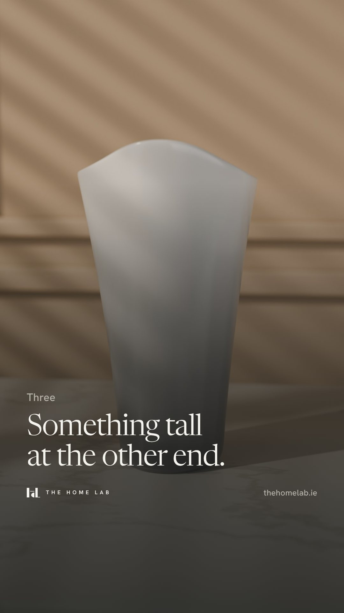  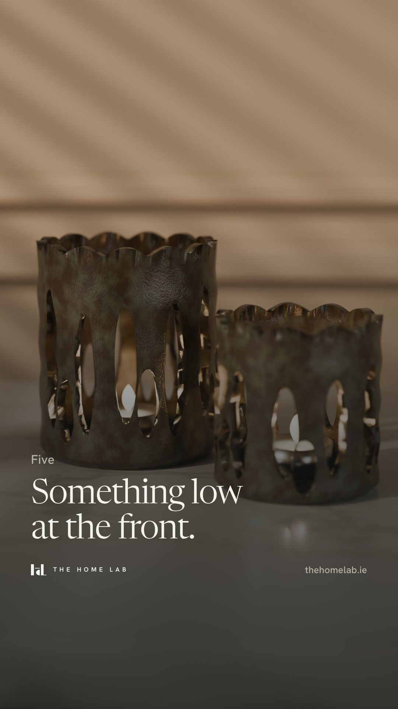 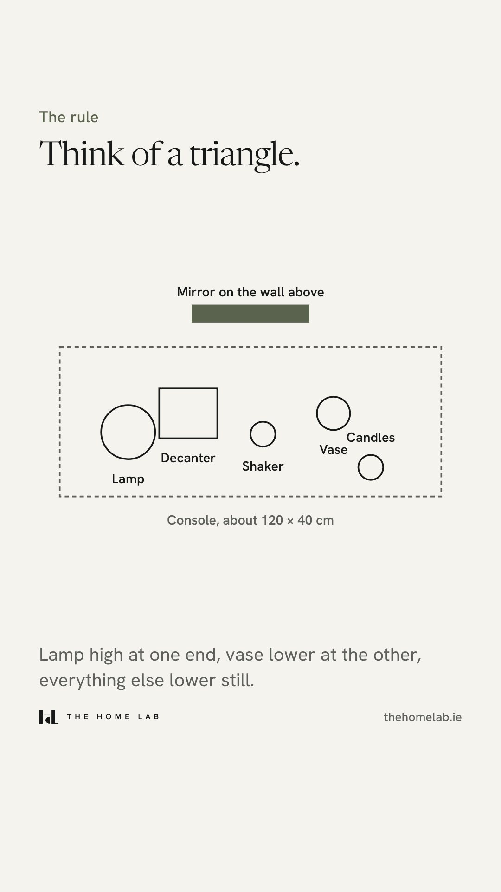</p>

| | |
| --- | --- |
| **Post** | Sat, 14 Nov 2026, 10:00 Irish time |
| **Where** | Instagram Reels, Facebook Reels, TikTok, Pinterest |
| **Pillar** | Styling |
| **Set** | The Milanese |
| **Links to** | `/journal/how-to-style-a-console-table` |
| **Creative** | [frame-01.jpg](creatives/post-11/frame-01.jpg), [frame-02.jpg](creatives/post-11/frame-02.jpg), [frame-03.jpg](creatives/post-11/frame-03.jpg), [frame-04.jpg](creatives/post-11/frame-04.jpg), [frame-05.jpg](creatives/post-11/frame-05.jpg), [frame-06.jpg](creatives/post-11/frame-06.jpg), [frame-07.jpg](creatives/post-11/frame-07.jpg), [reel.mp4](creatives/post-11/reel.mp4) |
| **Audio** | Upbeat but quiet instrumental from the commercial library. Text carries the content. |
| **Paid** | Yes. Best-performing format for cold audiences interested in interiors. TikTok-safe (no drinks shown in this cut). |

**Headline:** The five-piece console formula.

**On the creative, frame by frame:**

1. Styling / The five-piece console formula.
2. One / A lamp at one end. The anchor.
3. Two / A mirror above, centred.
4. Three / Something tall at the other end.
5. Four / Something reflective in the middle.
6. Five / Something low at the front.
7. The rule / Think of a triangle. / Lamp high at one end, vase lower at the other, everything else lower still.

**Caption:**

```text
The five-piece formula for a console table that looks finished, not cluttered:

1. A lamp at one end. The anchor.
2. A mirror above, centred. It doubles the light.
3. Something tall at the other end. A vase balances the lamp.
4. Something glass or reflective in the middle.
5. Something low at the front, like candle holders.

Think of a triangle: the lamp is the high point, the vase a lower one, everything else lower still.

The full guide, including the narrow-hallway version, is in our Journal.

#homebar #consolestyling #travertine #stylingtips #hallwaydecor
```

**Alt text:** A five-step console styling formula shown with a travertine lamp, wavy mirror, glass vase, shaker tins and candle holders, then a drawn plan of the console.

**How it is made:** Useful styling advice from the Journal, using the real Milanese pieces as the example. The plan frame is drawn from the set page’s layout.

<a id="post-12"></a>
### 12 · Sun, 15 Nov · Carousel · Buying gifts online this Christmas? Read this first.

<p>     </p>

| | |
| --- | --- |
| **Post** | Sun, 15 Nov 2026, 11:00 Irish time |
| **Where** | Instagram, Facebook |
| **Pillar** | Trust |
| **Set** | All |
| **Links to** | `/journal/christmas-delivery-ireland-guide` |
| **Creative** | [slide-01.jpg](creatives/post-12/slide-01.jpg), [slide-02.jpg](creatives/post-12/slide-02.jpg), [slide-03.jpg](creatives/post-12/slide-03.jpg), [slide-04.jpg](creatives/post-12/slide-04.jpg), [slide-05.jpg](creatives/post-12/slide-05.jpg), [slide-06.jpg](creatives/post-12/slide-06.jpg) |
| **Paid** | Yes. Facebook feed, 35+, gift buyers. This is the strongest trust message for Irish shoppers. |

**Headline:** Buying gifts online this Christmas? Read this first.

**On the creative, slide by slide:**

1. Christmas in Ireland / Buying gifts online this Christmas? Read this first.
2. No surprise charges / Posted from Ireland, so nothing to pay on the doorstep. / Since Brexit, many orders from Great Britain arrive with VAT and handling fees to pay. Ours don’t: the price in euro is the full price, with delivery added at checkout.
3. Straight to them / Send it to their door. / Put their name and address as the delivery address at checkout. The set arrives in its box.
4. Fixed dates / Order by 17 November. Ships by 12 December. / Every set in the Christmas batch is posted ahead of the busiest posting week.
5. Changed your mind? / Free changes until the batch closes. / After delivery, 14 days to cancel without giving a reason. Return a whole set or single pieces.
6. The Home Lab / Room sets and home gifts, posted from Ireland.

**Caption:**

```text
Five things worth knowing before you order Christmas gifts online, and how they work with us:

1. Since Brexit, many orders from Great Britain arrive with VAT, handling fees and sometimes duty to pay. We post from Ireland, so there's nothing to pay on the doorstep.
2. You can send a set straight to the person: put their name and address in delivery at checkout.
3. Our dates are fixed: order by 17 November and every set ships by 12 December.
4. You can change or cancel free of charge until the batch closes.
5. After delivery you have 14 days to cancel without giving a reason, and you can return a whole set or single pieces.

#christmasgiftsireland #giftideas #shopirish #shoplocalireland
```

**Alt text:** A dark card with the words: Buying gifts online this Christmas? Read this first.

**How it is made:** Plain facts about ordering, all of them true today: posted from Ireland, deliver to the recipient, real dates, free changes until the batch closes, 14-day returns.

<a id="post-13"></a>
### 13 · Mon, 16 Nov · Static · Christmas orders close tomorrow.

<p></p>

| | |
| --- | --- |
| **Post** | Mon, 16 Nov 2026, 19:00 Irish time |
| **Where** | Instagram, Instagram Stories, Facebook |
| **Pillar** | Deadline |
| **Set** | All |
| **Links to** | `/` |
| **Creative** | [slide-01.jpg](creatives/post-13/slide-01.jpg) |
| **Story version** | [story-01.jpg](creatives/post-13/story-01.jpg) |
| **Paid** | Yes. Deadline ad to warm audiences (site visitors, engagers, email list lookalike). |

**Headline:** Christmas orders close tomorrow.

**On the creative, slide by slide:**

1. Tuesday 17 November / Christmas orders close tomorrow. / Order by midnight. Every set ships by 12 December.

**Caption:**

```text
Christmas orders close tomorrow, Tuesday 17 November, at midnight.

Kyoto Kissaten €229. The Milanese €409. Single pieces from €24.

Everything ordered by then ships by 12 December, posted from Ireland. Link in bio.

#christmasgiftsireland #giftideas #shopirish
```

**Alt text:** A clay-coloured card: Christmas orders close tomorrow.

**How it is made:** Deadline card in clay, the brand’s accent colour, used sparingly so it stands out in the feed. Story version with a link sticker.

<a id="post-14"></a>
### 14 · Tue, 17 Nov · Reel · Last day to order for Christmas.

<p>    </p>

| | |
| --- | --- |
| **Post** | Tue, 17 Nov 2026, 08:00 Irish time |
| **Where** | Instagram Reels, Facebook Reels, TikTok |
| **Pillar** | Deadline |
| **Set** | All |
| **Links to** | `/` |
| **Creative** | [frame-01.jpg](creatives/post-14/frame-01.jpg), [frame-02.jpg](creatives/post-14/frame-02.jpg), [frame-03.jpg](creatives/post-14/frame-03.jpg), [frame-04.jpg](creatives/post-14/frame-04.jpg), [frame-05.jpg](creatives/post-14/frame-05.jpg), [reel.mp4](creatives/post-14/reel.mp4) |
| **Audio** | A recognisable, upbeat track from the commercial library. Repost to Stories at 12:00 and 20:00. |
| **Paid** | Yes. Run all day to warm audiences, then switch off at midnight. |

**Headline:** Last day to order for Christmas.

**On the creative, frame by frame:**

1. Tuesday 17 November / Last day to order for Christmas.
2. Kyoto Kissaten / The coffee counter. €229.
3. The Milanese / The drinks corner. €409.
4. Small gifts / Pieces from €24.
5. Midnight tonight / Order today. Ships by 12 December. / thehomelab.ie

**Caption:**

```text
Today is the last day to order for Christmas. Orders close at midnight; everything in the batch ships by 12 December.

Kyoto Kissaten, the pour-over coffee counter: €229.
The Milanese, the evening drinks corner: €409.
Single pieces from €24.

Link in bio.

#christmasgiftsireland #giftideas #shopirish #irishinteriors
```

**Alt text:** A short video: last day to order for Christmas, showing Kyoto Kissaten, The Milanese and small gifts, closing at midnight.

**How it is made:** Fast deadline reel: the two sets, the under-€50 pieces and the hard cut-off. Repost to Stories through the day.

<a id="post-15"></a>
### 15 · Tue, 17 Nov · Pin · Milan-style home bar: everything for one console

<p></p>

| | |
| --- | --- |
| **Post** | Tue, 17 Nov 2026, 21:00 Irish time |
| **Where** | Pinterest |
| **Pillar** | Search and saves |
| **Set** | The Milanese |
| **Links to** | `/sets/the-milanese` |
| **Creative** | [slide-01.jpg](creatives/post-15/slide-01.jpg) |
| **Pinterest board** | Home bar and console styling |
| **Paid** | Yes. Pinterest consideration campaign, keywords: home bar ideas, console table styling, travertine lamp. |

**Headline:** Milan-style home bar: everything for one console

**Pin title:** Milan-style home bar console: travertine lamp, crystal decanter, wavy mirror and shaker in one set

**On the creative, slide by slide:**

1. The Milanese · €409 / Milan-style home bar: everything for one console.

**Caption:**

```text
A Milan-style home bar for a console or sideboard, in one box: cut-crystal whisky decanter with four glasses, two-tin Boston cocktail shaker, travertine mushroom lamp, wavy pine-framed wall mirror, mouth-blown glass vase and two ceramic candle holders. Home bar ideas and console table styling for a living or dining room. Posted from Ireland.
```

**Alt text:** A Milan-style drinks console with a travertine lamp, crystal decanter, steel shaker, glass vase, candle holders and wavy mirror.

**How it is made:** Pinterest pin, 2:3, with a search-friendly title and description.

## Phase 2: gifting season

<a id="post-16"></a>
### 16 · Wed, 18 Nov · Carousel · The Christmas batch is closed. Here’s what happens next.

<p>    </p>

| | |
| --- | --- |
| **Post** | Wed, 18 Nov 2026, 12:30 Irish time |
| **Where** | Instagram, Facebook |
| **Pillar** | Behind the scenes |
| **Set** | All |
| **Links to** | `/` |
| **Creative** | [slide-01.jpg](creatives/post-16/slide-01.jpg), [slide-02.jpg](creatives/post-16/slide-02.jpg), [slide-03.jpg](creatives/post-16/slide-03.jpg), [slide-04.jpg](creatives/post-16/slide-04.jpg), [slide-05.jpg](creatives/post-16/slide-05.jpg) |
| **Alternate** | [slide-05-alt.jpg](creatives/post-16/slide-05-alt.jpg) |
| **Paid** | No. Organic trust post. |
| **Depends on** | Slide 5 announces a second Christmas batch (orders close 30 November, ships by 18 December). If there is no second batch, use slide-05-alt.jpg, which uses the shop’s current wording. |

**Headline:** The Christmas batch is closed. Here’s what happens next.

**On the creative, slide by slide:**

1. Thank you / The Christmas batch is closed. Here’s what happens next.
2. First / We order every piece for every set in the batch. / Sets are made up in batches, so nothing sits in a warehouse for months.
3. Then / We check each piece and pack every set in one box, in Ireland.
4. By 12 December / Every set is posted. / You get an email with tracking when yours leaves.
5. Missed it? / A second Christmas batch is open until 30 November. / Every set in it ships by 18 December. *(alternate: Ordering now? / Sets are packed to order and posted within three weeks. / The date is in your basket before you pay.)*

**Caption:**

```text
The Christmas batch closed at midnight. Thank you. Here's what happens now:

We order every piece for every set in the batch. Nothing sits in a warehouse for months.
We check each piece and pack every set in one box, here in Ireland.
Every set is posted by 12 December, and you'll get a tracking email when yours leaves.

Missed it? A second Christmas batch is open until 30 November and ships by 18 December.

#irishinteriors #shopirish #irishhomes #smallbusinessireland
```

**Alternate caption** (if the dependency is not in place):

```text
Missed it? Sets ordered now are packed to order and posted within three weeks. The date is shown in your basket before you pay.

#irishinteriors #shopirish #irishhomes #smallbusinessireland
```

**Alt text:** A card reading: The Christmas batch is closed. Here’s what happens next.

**How it is made:** Explains the batch model in plain words, so pre-order feels like a reason to trust, not a risk. No people or premises needed: type slides plus the contents photo.

<a id="post-17"></a>
### 17 · Thu, 19 Nov · Reel · Milan, 7pm. What is aperitivo?

<p>     </p>

| | |
| --- | --- |
| **Post** | Thu, 19 Nov 2026, 19:00 Irish time |
| **Where** | Instagram Reels, Facebook Reels |
| **Pillar** | Place and culture |
| **Set** | The Milanese |
| **Links to** | `/sets/the-milanese` |
| **Creative** | [frame-01.jpg](creatives/post-17/frame-01.jpg), [frame-02.jpg](creatives/post-17/frame-02.jpg), [frame-03.jpg](creatives/post-17/frame-03.jpg), [frame-04.jpg](creatives/post-17/frame-04.jpg), [frame-05.jpg](creatives/post-17/frame-05.jpg), [frame-06.jpg](creatives/post-17/frame-06.jpg), [reel.mp4](creatives/post-17/reel.mp4) |
| **Audio** | Light Italian jazz or bossa from the commercial library. Post at 19:00 Irish time (20:00 in Milan). |
| **Paid** | Yes on Instagram and Facebook, 25+. Not for TikTok ads (drinks shown). |

**Headline:** Milan, 7pm. What is aperitivo?

**On the creative, frame by frame:**

1. Milan, 7pm / What is aperitivo?
2. The drink before dinner, usually between seven and nine in the evening.
3. At home, it’s poured from a console kept for it,
4. with a decanter and a few good glasses,
5. and a lamp instead of the ceiling light.
6. The Milanese · €409 / The whole corner, in one box.

**Caption:**

```text
In Milan, aperitivo is the drink before dinner, usually between seven and nine in the evening.

At home it's poured from a console or sideboard kept for it: a decanter, a few good glasses, and a lamp instead of the ceiling light.

The Milanese is that corner, in one box. €409. Please enjoy responsibly.

#homebar #consolestyling #travertine #aperitivo #milanostyle
```

**Alt text:** A short video about aperitivo in Milan, showing a travertine lamp, a crystal decanter, candle holders and the finished Milanese console.

**How it is made:** A place-led reel: what aperitivo is, then the pieces that make the corner. Supplier photos throughout.

<a id="post-18"></a>
### 18 · Fri, 20 Nov · Carousel · Kris Kindle sorted: five gifts under €50.

<p>      </p>

| | |
| --- | --- |
| **Post** | Fri, 20 Nov 2026, 12:30 Irish time |
| **Where** | Instagram, Facebook, Pinterest |
| **Pillar** | Gifting |
| **Set** | Pieces |
| **Links to** | `/gifts` |
| **Creative** | [slide-01.jpg](creatives/post-18/slide-01.jpg), [slide-02.jpg](creatives/post-18/slide-02.jpg), [slide-03.jpg](creatives/post-18/slide-03.jpg), [slide-04.jpg](creatives/post-18/slide-04.jpg), [slide-05.jpg](creatives/post-18/slide-05.jpg), [slide-06.jpg](creatives/post-18/slide-06.jpg), [slide-07.jpg](creatives/post-18/slide-07.jpg) |
| **Paid** | Yes. Gift-intent catalogue ad, 25+, all of Ireland. Office Kris Kindle timing. |

**Headline:** Kris Kindle sorted: five gifts under €50.

**On the creative, slide by slide:**

1. Kris Kindle / Five gifts under €50.
2. €24 / Ceramic candle holders, a pair.
3. €29 / Boston shaker, two steel tins.
4. €32 / Acacia serving board.
5. €38 / Glass dripper with jug.
6. €44 / Blown glass vase, 24 cm.
7. All in the shop / Every piece is sold on its own. / thehomelab.ie/gifts

**Caption:**

```text
Kris Kindle, sorted. Five gifts under €50, each sold on its own:

€24 Pair of ceramic candle holders
€29 Boston cocktail shaker, two steel tins
€32 Acacia serving board
€38 Glass pour-over dripper with jug
€44 Blown glass vase, 24 cm

Send this to the group chat.

#kriskindle #christmasgiftsireland #giftideas #shopirish #secretsanta
```

**Alt text:** Five gifts under €50: ceramic candle holders, a steel cocktail shaker, an acacia board, a glass coffee dripper and a blown glass vase.

**How it is made:** Small gifts, each a piece sold on its own. Built for saves and shares into group chats.

<a id="post-19"></a>
### 19 · Sat, 21 Nov · Static · Three minutes. One cup. No machine.

<p></p>

| | |
| --- | --- |
| **Post** | Sat, 21 Nov 2026, 09:00 Irish time |
| **Where** | Instagram, Facebook, Pinterest |
| **Pillar** | Place and mood |
| **Set** | Kyoto Kissaten |
| **Links to** | `/sets/kyoto-kissaten` |
| **Creative** | [slide-01.jpg](creatives/post-19/slide-01.jpg) |
| **Paid** | Yes. Kyoto sales ad variant (test against post 2). |

**Headline:** Three minutes. One cup. No machine.

**On the creative, slide by slide:**

1. Kyoto Kissaten / Three minutes. One cup. No machine.

**Caption:**

```text
Pour-over takes about three minutes. Fresh grounds in a paper filter, hot water poured slowly over them, coffee dripping through into the jug.

It tastes cleaner and lighter than coffee from a machine, and it turns the first cup of the day into a small ritual.

Kyoto Kissaten has everything for it, apart from the beans. €229.

#pourover #coffeeathome #kissaten #slowmornings #coffeeireland
```

**Alt text:** An amber glass pour-over dripper on its jug on a café counter, with the words: Three minutes. One cup. No machine.

**How it is made:** The supplier’s café photo of the dripper in use, full-bleed, with a short line. Saturday morning post.

<a id="post-20"></a>
### 20 · Sun, 22 Nov · Carousel · Three classic cocktails for a Boston shaker.

<p>      </p>

| | |
| --- | --- |
| **Post** | Sun, 22 Nov 2026, 17:00 Irish time |
| **Where** | Instagram, Facebook |
| **Pillar** | Ritual and how-to |
| **Set** | The Milanese |
| **Links to** | `/journal/boston-shaker-cocktails` |
| **Creative** | [slide-01.jpg](creatives/post-20/slide-01.jpg), [slide-02.jpg](creatives/post-20/slide-02.jpg), [slide-03.jpg](creatives/post-20/slide-03.jpg), [slide-04.jpg](creatives/post-20/slide-04.jpg), [slide-05.jpg](creatives/post-20/slide-05.jpg), [slide-06.jpg](creatives/post-20/slide-06.jpg), [slide-07.jpg](creatives/post-20/slide-07.jpg) |
| **Paid** | No. Organic only. Do not boost alcohol recipes (Irish alcohol advertising rules and platform policy). |

**Headline:** Three classic cocktails for a Boston shaker.

**On the creative, slide by slide:**

1. Home bar / Three classic cocktails for a Boston shaker.
2. Won’t come apart? / Don’t twist. Tap the big tin just below the rim. / On the side where the small tin leans away. It releases at once.
3. One / Whiskey sour. / The best way to learn the balance of strong, sour and sweet. Irish whiskey works beautifully.
4. Two / Daiquiri. / Not the frozen kind. The original is three ingredients and one of the best drinks there is.
5. Three / Espresso martini. / No espresso machine? Pour-over made at double strength works.
6. Without alcohol / Shaken iced coffee. / 50 ml strong coffee, 15 ml syrup, plenty of ice. Shake hard for the foam.
7. Full recipes in the Journal / Please drink responsibly. / drinkaware.ie

**Caption:**

```text
A Boston shaker is two steel tins that fit together. It's what most bartenders use, and once you know the trick it's quicker and less messy than a three-piece shaker.

Stuck? Don't twist or pull. Tap the big tin firmly just below the rim, on the side where the small tin leans away. It releases at once.

Three to start with: a whiskey sour (Irish whiskey works beautifully), the original daiquiri, and an espresso martini made with double-strength pour-over. Plus an alcohol-free shaken iced coffee.

Full recipes in the Journal. Please drink responsibly: drinkaware.ie

#homebar #cocktailsathome #bostonshaker #mocktails
```

**Alt text:** Two polished steel Boston shaker tins, with the title: Three classic cocktails for a Boston shaker.

**How it is made:** Useful content from the Journal, with an alcohol-free option and a drinkaware.ie line. Keep organic.

<a id="post-21"></a>
### 21 · Mon, 23 Nov · Pin · How to style a console table: the five-piece formula

<p></p>

| | |
| --- | --- |
| **Post** | Mon, 23 Nov 2026, 21:00 Irish time |
| **Where** | Pinterest |
| **Pillar** | Search and saves |
| **Set** | The Milanese |
| **Links to** | `/journal/how-to-style-a-console-table` |
| **Creative** | [slide-01.jpg](creatives/post-21/slide-01.jpg) |
| **Pinterest board** | Home bar and console styling |
| **Paid** | Optional. Pinterest traffic campaign to the Journal article. |

**Headline:** How to style a console table: the five-piece formula

**Pin title:** How to style a console table: a five-piece formula that works

**On the creative, slide by slide:**

1. Console styling / The five-piece formula. / Lamp at one end, mirror above, vase at the other, glass in the middle, candles in front.

**Caption:**

```text
How to style a console table with five pieces: a lamp at one end, a mirror centred above, something tall at the other end, something glass in the middle and something low at the front. Think of a triangle. Includes the narrow-hallway version and the drinks console version.
```

**Alt text:** A drawn top-down plan of a styled console: lamp, decanter, shaker, vase, candles and a mirror above.

**How it is made:** A drawn-plan pin that links to the Journal article. Plans like this save well on Pinterest.

<a id="post-22"></a>
### 22 · Tue, 24 Nov · Reel · Do you need a gooseneck kettle?

<p>     </p>

| | |
| --- | --- |
| **Post** | Tue, 24 Nov 2026, 08:00 Irish time |
| **Where** | Instagram Reels, Facebook Reels, TikTok |
| **Pillar** | Ritual and how-to |
| **Set** | Kyoto Kissaten |
| **Links to** | `/products/gooseneck-kettle` |
| **Creative** | [frame-01.jpg](creatives/post-22/frame-01.jpg), [frame-02.jpg](creatives/post-22/frame-02.jpg), [frame-03.jpg](creatives/post-22/frame-03.jpg), [frame-04.jpg](creatives/post-22/frame-04.jpg), [frame-05.jpg](creatives/post-22/frame-05.jpg), [frame-06.jpg](creatives/post-22/frame-06.jpg), [reel.mp4](creatives/post-22/reel.mp4) |
| **Audio** | Calm instrumental from the commercial library. |
| **Paid** | Yes. TikTok and Reels ad to coffee interests; the question hook works for cold audiences. |

**Headline:** Do you need a gooseneck kettle?

**On the creative, frame by frame:**

1. Pour-over, honestly / Do you need a gooseneck kettle?
2. Not strictly. Some people pour from a small jug and do fine.
3. But an ordinary kettle pours too fast and floods the coffee.
4. A long, thin spout gives you a slow, steady stream.
5. €55 / Electric, 1 litre, lifts off its base to pour.
6. Our advice / If you’re buying a kettle anyway, buy a gooseneck.

**Caption:**

```text
Do you need a gooseneck kettle for pour-over? Not strictly. Some people pour from a small jug and do fine.

But an ordinary kettle pours too fast and floods the coffee. A gooseneck's long, thin spout makes it much easier to pour slowly and evenly, which is where most beginners go wrong.

If you're buying a kettle anyway, buy a gooseneck. Ours is electric, 1 litre, €55, and it's in the Kyoto Kissaten set.

#pourover #coffeeathome #kissaten #coffeetips #gooseneckkettle
```

**Alt text:** A short video answering whether you need a gooseneck kettle, showing the black electric gooseneck kettle and the amber glass dripper.

**How it is made:** An honest answer (“not strictly”), which is more persuasive than a hard sell. Supplier photos of the kettle and dripper.

<a id="post-23"></a>
### 23 · Wed, 25 Nov · Carousel · Housewarming gifts that will still be out in a year.

<p>     </p>

| | |
| --- | --- |
| **Post** | Wed, 25 Nov 2026, 12:30 Irish time |
| **Where** | Instagram, Facebook, Pinterest |
| **Pillar** | Gifting |
| **Set** | Pieces |
| **Links to** | `/journal/housewarming-gifts-ireland` |
| **Creative** | [slide-01.jpg](creatives/post-23/slide-01.jpg), [slide-02.jpg](creatives/post-23/slide-02.jpg), [slide-03.jpg](creatives/post-23/slide-03.jpg), [slide-04.jpg](creatives/post-23/slide-04.jpg), [slide-05.jpg](creatives/post-23/slide-05.jpg), [slide-06.jpg](creatives/post-23/slide-06.jpg) |
| **Paid** | Yes. Facebook and Instagram, 25–44, “recently moved” and home interests. |

**Headline:** Housewarming gifts that will still be out in a year.

**On the creative, slide by slide:**

1. Housewarming / Gifts that will still be out in a year.
2. €139 / A lamp for the corner with no light.
3. €149 / A mirror for the bare wall above the hall table.
4. €44 / A vase for the first flowers.
5. €32 / A board for the first time they have people over.
6. A group gift / Or a whole corner. / The Milanese €409 · Kyoto Kissaten €229

**Caption:**

```text
New homes have bare corners: a hall table with nothing on it, a wall with no mirror, a counter with only the kettle.

The best housewarming gifts fill one of those gaps with something they'll keep out on display:

A lamp for the corner with no light. €139.
A mirror for the bare wall above the hall table. €149.
A vase for the first flowers. €44.
A board for the first time they have people over. €32.

Family, or a group of friends clubbing together? A whole set: The Milanese €409, Kyoto Kissaten €229.

#housewarminggift #newhome #firsthome #irishhomes #shopirish
```

**Alt text:** Housewarming gift ideas: a travertine lamp, a wavy mirror, a blown glass vase and an acacia board.

**How it is made:** Gifts that fill a real gap in a new home, one per slide. Uses the Journal’s housewarming angle.

<a id="post-24"></a>
### 24 · Thu, 26 Nov · Reel · Is a hand grinder worth it? An honest answer.

<p>     </p>

| | |
| --- | --- |
| **Post** | Thu, 26 Nov 2026, 08:00 Irish time |
| **Where** | Instagram Reels, Facebook Reels, TikTok |
| **Pillar** | Product truth |
| **Set** | Kyoto Kissaten |
| **Links to** | `/journal/is-a-hand-grinder-worth-it-hario-skerton` |
| **Creative** | [frame-01.jpg](creatives/post-24/frame-01.jpg), [frame-02.jpg](creatives/post-24/frame-02.jpg), [frame-03.jpg](creatives/post-24/frame-03.jpg), [frame-04.jpg](creatives/post-24/frame-04.jpg), [frame-05.jpg](creatives/post-24/frame-05.jpg), [frame-06.jpg](creatives/post-24/frame-06.jpg), [reel.mp4](creatives/post-24/reel.mp4) |
| **Audio** | Calm instrumental from the commercial library. |
| **Paid** | Yes. Reels and TikTok to coffee interests. Honest-review hooks hold attention. |

**Headline:** Is a hand grinder worth it? An honest answer.

**On the creative, frame by frame:**

1. Honest review / Is a hand grinder worth it?
2. We sell one, so here’s both sides.
3. Good / An even grind for pour-over. Almost silent at 7am.
4. Not so good / About a minute of turning per cup. / Coarse settings are less even, and it’s not for daily espresso.
5. Who it suits / One to three cups at a time, made slowly.
6. €89 on its own / Or in Kyoto Kissaten, €229.

**Caption:**

```text
We sell the Hario hand grinder, so here's both sides.

What it does well: an even grind at pour-over settings, ceramic burrs that don't rust, and it's almost silent, so it won't wake the house at 7am.

Its limits: grinding 15 g for one cup takes about a minute of steady turning, coarse settings are less even, and it's not for daily espresso.

It suits someone making one to three cups at a time, slowly. €89 on its own, or in Kyoto Kissaten.

#pourover #coffeeathome #kissaten #hario #coffeegrinder
```

**Alt text:** A short video reviewing the Hario hand grinder, showing the grinder and its glass jar of ground coffee.

**How it is made:** Pros and limits from the Journal’s review of the Hario grinder. Saying where it falls short is what makes it believable.

<a id="post-25"></a>
### 25 · Fri, 27 Nov · Carousel · No Black Friday sale here.

<p>    </p>

| | |
| --- | --- |
| **Post** | Fri, 27 Nov 2026, 08:00 Irish time |
| **Where** | Instagram, Facebook |
| **Pillar** | Trust |
| **Set** | All |
| **Links to** | `/` |
| **Creative** | [slide-01.jpg](creatives/post-25/slide-01.jpg), [slide-02.jpg](creatives/post-25/slide-02.jpg), [slide-03.jpg](creatives/post-25/slide-03.jpg), [slide-04.jpg](creatives/post-25/slide-04.jpg), [slide-05.jpg](creatives/post-25/slide-05.jpg) |
| **Paid** | Yes. Black Friday weekend, warm audiences. Contrarian message stands out in a feed full of percentages. |

**Headline:** No Black Friday sale here.

**On the creative, slide by slide:**

1. Black Friday / No Black Friday sale here.
2. No countdown timers. No “was” prices. / What there is, every day: each set costs less than its pieces bought one by one.
3. Every day / Pieces vs set
4. And if it’s not right / 14 days to return it, whole or piece by piece.
5. The Home Lab / Bought once. Used every evening.

**Caption:**

```text
No Black Friday sale here. No countdown timers, no "was" prices.

What there is, every day: each set costs less than its pieces bought one by one.

Kyoto Kissaten: €279 in pieces, €229 as a set.
The Milanese: €484 in pieces, €409 as a set.

And if it's not right, you have 14 days after delivery to return it, whole or piece by piece.

#blackfriday #shopirish #irishinteriors #buylessbuybetter
```

**Alt text:** A dark card with the words: No Black Friday sale here.

**How it is made:** Black Friday post with no discount. The everyday set saving is the offer. No “was” prices, only the real piece prices.

<a id="post-26"></a>
### 26 · Sat, 28 Nov · Static · A mirror doubles the candlelight.

<p></p>

| | |
| --- | --- |
| **Post** | Sat, 28 Nov 2026, 20:00 Irish time |
| **Where** | Instagram, Facebook, Pinterest |
| **Pillar** | Place and mood |
| **Set** | The Milanese |
| **Links to** | `/products/wavy-wall-mirror` |
| **Creative** | [slide-01.jpg](creatives/post-26/slide-01.jpg) |
| **Paid** | Optional. Product ad for the mirror (€149) to home-decor interests. |

**Headline:** A mirror doubles the candlelight.

**On the creative, slide by slide:**

1. The Milanese / A mirror doubles the candlelight.

**Caption:**

```text
A mirror above the console doubles the lamp and candlelight in the evening, and makes the corner feel like part of the room rather than a shelf.

Ours is tall, with a wavy outline and a rounded natural pine frame. €149 on its own, or in The Milanese.

Hang it centred, with its bottom edge about 20 cm above the console.

#homebar #consolestyling #travertine #wavymirror #interiorstyling
```

**Alt text:** A tall wavy mirror with a natural pine frame above a marble console with a glass vase and a candle holder.

**How it is made:** The real mirror photo above the console. One idea, said simply.

<a id="post-27"></a>
### 27 · Sun, 29 Nov · Carousel · Give €15. Get €15.

<p>   </p>

| | |
| --- | --- |
| **Post** | Sun, 29 Nov 2026, 11:00 Irish time |
| **Where** | Instagram, Facebook |
| **Pillar** | Community |
| **Set** | All |
| **Links to** | `/account/referrals` |
| **Creative** | [slide-01.jpg](creatives/post-27/slide-01.jpg), [slide-02.jpg](creatives/post-27/slide-02.jpg), [slide-03.jpg](creatives/post-27/slide-03.jpg), [slide-04.jpg](creatives/post-27/slide-04.jpg) |
| **Paid** | No. Organic and email. |
| **Depends on** | Needs member accounts and the referral discount live in Shopify. If not live yet, move this post to January. |

**Headline:** Give €15. Get €15.

**On the creative, slide by slide:**

1. Members / Give €15. Get €15.
2. One / Share your link from your account.
3. Two / Your friend gets €15 off their first order.
4. Three / When it ships, you get €15 credit. / thehomelab.ie/account

**Caption:**

```text
Know someone who'd love a corner of Kyoto or Milan at home?

Share your link from your account. Your friend gets €15 off their first order, and when it ships, you get €15 credit.

Sign in or create an account at thehomelab.ie.

#shopirish #irishhomes #giftideas
```

**Alt text:** An olive card: Give €15. Get €15.

**How it is made:** The member referral programme, in three facts.

<a id="post-28"></a>
### 28 · Mon, 30 Nov · Static · Last call: the second Christmas batch closes tonight.

<p></p>

| | |
| --- | --- |
| **Post** | Mon, 30 Nov 2026, 19:00 Irish time |
| **Where** | Instagram, Instagram Stories, Facebook |
| **Pillar** | Deadline |
| **Set** | All |
| **Links to** | `/` |
| **Creative** | [slide-01.jpg](creatives/post-28/slide-01.jpg) |
| **Story version** | [story-01.jpg](creatives/post-28/story-01.jpg) |
| **Alternate** | [slide-01-alt.jpg](creatives/post-28/slide-01-alt.jpg), [story-01-alt.jpg](creatives/post-28/story-01-alt.jpg) |
| **Paid** | Yes. Cyber Monday, warm audiences, all day. |
| **Depends on** | Second Christmas batch. If there is none, post slide-01-alt.jpg with the alternate caption. |

**Headline:** Last call: the second Christmas batch closes tonight.

**On the creative, slide by slide:**

1. Last call · Monday 30 November / The second Christmas batch closes tonight. / Every set in it ships by 18 December. *(alternate: Ordering today? / Packed to order, posted within three weeks. / The date is in your basket before you pay.)*

**Caption:**

```text
Last call. The second Christmas batch closes at midnight tonight, and every set in it ships by 18 December.

Kyoto Kissaten €229. The Milanese €409. Pieces from €24. Link in bio.

#christmasgiftsireland #giftideas #cybermonday #shopirish
```

**Alternate caption** (if the dependency is not in place):

```text
Ordering today? Every set is packed to order and posted within three weeks, and the date is shown in your basket before you pay. Kyoto Kissaten €229. The Milanese €409.

#christmasgiftsireland #giftideas #cybermonday #shopirish
```

**Alt text:** A clay card: Last call. The second Christmas batch closes tonight.

**How it is made:** Cyber Monday deadline card.

<a id="post-29"></a>
### 29 · Tue, 1 Dec · Carousel · A gift guide in four people.

<p>     </p>

| | |
| --- | --- |
| **Post** | Tue, 1 Dec 2026, 12:30 Irish time |
| **Where** | Instagram, Facebook, Pinterest |
| **Pillar** | Gifting |
| **Set** | All |
| **Links to** | `/gifts` |
| **Creative** | [slide-01.jpg](creatives/post-29/slide-01.jpg), [slide-02.jpg](creatives/post-29/slide-02.jpg), [slide-03.jpg](creatives/post-29/slide-03.jpg), [slide-04.jpg](creatives/post-29/slide-04.jpg), [slide-05.jpg](creatives/post-29/slide-05.jpg), [slide-06.jpg](creatives/post-29/slide-06.jpg) |
| **Paid** | Yes. Advantage+ catalogue or carousel ad, 25+, gift interests. |

**Headline:** A gift guide in four people.

**On the creative, slide by slide:**

1. Christmas / A gift guide in four people.
2. The one who knows their café order by heart / Kyoto Kissaten, €229.
3. The friend whose house everyone ends up in / The Milanese, €409.
4. The new homeowner / Travertine lamp, €139.
5. The Kris Kindle / Candle holders, €24.
6. More ideas / The full gift guide is on our site. / thehomelab.ie/gifts

**Caption:**

```text
A gift guide in four people:

The one who knows their café order by heart: Kyoto Kissaten, €229.
The friend whose house everyone ends up in: The Milanese, €409.
The new homeowner: the travertine lamp, €139.
The Kris Kindle: a pair of ceramic candle holders, €24.

Tag the person you're buying for. (Or the person who should be buying for you.)

#christmasgiftsireland #giftideas #giftguide #shopirish
```

**Alt text:** A gift guide matching four people to gifts: the coffee person, the host, the new homeowner and the Kris Kindle.

**How it is made:** Match the person to the gift. Fast to read, easy to share.

<a id="post-30"></a>
### 30 · Wed, 2 Dec · Reel · It’s 7am in Kyoto.

<p>     </p>

| | |
| --- | --- |
| **Post** | Wed, 2 Dec 2026, 22:00 Irish time |
| **Where** | Instagram Reels, Facebook Reels, TikTok |
| **Pillar** | Place and mood |
| **Set** | Kyoto Kissaten |
| **Links to** | `/sets/kyoto-kissaten` |
| **Creative** | [frame-01.jpg](creatives/post-30/frame-01.jpg), [frame-02.jpg](creatives/post-30/frame-02.jpg), [frame-03.jpg](creatives/post-30/frame-03.jpg), [frame-04.jpg](creatives/post-30/frame-04.jpg), [frame-05.jpg](creatives/post-30/frame-05.jpg), [frame-06.jpg](creatives/post-30/frame-06.jpg), [reel.mp4](creatives/post-30/reel.mp4) |
| **Audio** | Quiet, warm piano or ambient from the commercial library. |
| **Paid** | Yes. Kyoto awareness, Reels and TikTok. |

**Headline:** It’s 7am in Kyoto.

**On the creative, frame by frame:**

1. Right now / It’s 7am in Kyoto.
2. Somewhere on a side street, a coffee house is opening.
3. The kettle goes on.
4. Beans are ground by hand.
5. Water is poured slowly, one cup at a time.
6. Kyoto Kissaten · €229 / The counter, in one box.

**Caption:**

```text
Right now it's 7am in Kyoto. Somewhere on a side street, a coffee house is opening.

The kettle goes on. Beans are ground by hand. Water is poured slowly, one cup at a time.

Kyoto Kissaten is that counter, in one box. Yours tomorrow morning, if you like.

#pourover #coffeeathome #kissaten #kyoto #slowmornings
```

**Alt text:** A short video: it’s 7am in Kyoto, showing the kettle, the hand grinder, the glass dripper and the cups from the Kyoto Kissaten set.

**How it is made:** Post at 22:00 Irish time, which is exactly 07:00 in Kyoto in winter. A slow, quiet reel about the morning ritual.

<a id="post-31"></a>
### 31 · Thu, 3 Dec · Pin · Gifts for coffee lovers in Ireland, by budget

<p></p>

| | |
| --- | --- |
| **Post** | Thu, 3 Dec 2026, 21:00 Irish time |
| **Where** | Pinterest |
| **Pillar** | Search and saves |
| **Set** | Kyoto Kissaten |
| **Links to** | `/journal/gifts-for-coffee-lovers-ireland` |
| **Creative** | [slide-01.jpg](creatives/post-31/slide-01.jpg) |
| **Pinterest board** | Christmas gift ideas Ireland |
| **Paid** | Yes. Pinterest, keywords: coffee gifts, gifts for coffee lovers, christmas gifts ireland. |

**Headline:** Gifts for coffee lovers in Ireland, by budget

**Pin title:** Gifts for coffee lovers in Ireland: an honest guide by budget

**On the creative, slide by slide:**

1. Gift guide / Gifts for coffee lovers in Ireland, by budget. / Or all of it, as Kyoto Kissaten: €229.

**Caption:**

```text
Gifts for coffee lovers in Ireland, by budget: an acacia serving board (€32), a glass pour-over dripper with jug (€38), an electric gooseneck kettle (€55), a Hario ceramic hand grinder (€89), or the full Kyoto Kissaten pour-over set (€229). Posted from Ireland, no customs charges.
```

**Alt text:** Four coffee gifts with prices: acacia board €32, glass dripper €38, gooseneck kettle €55 and Hario grinder €89.

**How it is made:** Grid pin of four coffee pieces with prices, linking to the Journal’s coffee gift guide.

<a id="post-32"></a>
### 32 · Fri, 4 Dec · Static · Crystal, stone and candlelight.

<p></p>

| | |
| --- | --- |
| **Post** | Fri, 4 Dec 2026, 20:00 Irish time |
| **Where** | Instagram, Facebook, Pinterest |
| **Pillar** | Place and mood |
| **Set** | The Milanese |
| **Links to** | `/sets/the-milanese` |
| **Creative** | [slide-01.jpg](creatives/post-32/slide-01.jpg) |
| **Paid** | Optional. Pinterest and Instagram, home-decor interests. |

**Headline:** Crystal, stone and candlelight.

**On the creative, slide by slide:**

1. The Milanese / Crystal, stone and candlelight.

**Caption:**

```text
The Milanese, as a palette: travertine, Calacatta marble, polished steel, whisky amber and natural pine.

Milan homes are known for these materials: stone, polished metal, cut glass and plaster walls, lit low in the evening. The set uses the same ones on one console.

#homebar #consolestyling #travertine #colourpalette #interiorstyling
```

**Alt text:** The Milanese set above five colour swatches: travertine, Calacatta marble, polished steel, whisky amber and natural pine.

**How it is made:** The set’s palette (from the set page) under the real set photo. Palette posts save well with interiors audiences.

<a id="post-33"></a>
### 33 · Sat, 5 Dec · Carousel · Pour-over, cafetière or moka pot?

<p>    </p>

| | |
| --- | --- |
| **Post** | Sat, 5 Dec 2026, 10:00 Irish time |
| **Where** | Instagram, Facebook, Pinterest |
| **Pillar** | Ritual and how-to |
| **Set** | Kyoto Kissaten |
| **Links to** | `/journal/pour-over-vs-cafetiere-vs-moka-pot` |
| **Creative** | [slide-01.jpg](creatives/post-33/slide-01.jpg), [slide-02.jpg](creatives/post-33/slide-02.jpg), [slide-03.jpg](creatives/post-33/slide-03.jpg), [slide-04.jpg](creatives/post-33/slide-04.jpg), [slide-05.jpg](creatives/post-33/slide-05.jpg) |
| **Paid** | Optional. Engagement ad; comparison posts get comments. |

**Headline:** Pour-over, cafetière or moka pot?

**On the creative, slide by slide:**

1. Coffee at home / Pour-over, cafetière or moka pot?
2. The cafetière / Full and heavy. / Choose it if you want the easiest method or make coffee for several people at once. For a busy weekday it is hard to beat.
3. The moka pot / Strong, close to espresso. / Choose it if you like strong coffee or make lattes at home. Take it off the heat as soon as it gurgles.
4. Pour-over / Clean and light. / Choose it if you drink coffee black and like tasting the difference between beans.
5. Our answer / Keep two. / A cafetière for busy mornings. Pour-over for the slow weekend cup.

**Caption:**

```text
Most Irish kitchens already have a cafetière, and plenty have a moka pot from a holiday in Italy. So is pour-over worth adding?

Cafetière: full and heavy. The easiest method, and great for several people.
Moka pot: strong, close to espresso. Best if you like lattes at home.
Pour-over: clean and light. Best if you drink coffee black and like tasting different beans.

Plenty of people keep two: a cafetière for busy mornings, pour-over for the slow weekend cup. Which are you?

#pourover #coffeeathome #kissaten #cafetiere #mokapot
```

**Alt text:** A comparison of three coffee methods: pour-over, cafetière and moka pot.

**How it is made:** A fair comparison from the Journal. Recommending the cafetière for busy mornings is what makes the pour-over pitch credible.

<a id="post-34"></a>
### 34 · Mon, 7 Dec · Static · Too late to post? Gift a place.

<p></p>

| | |
| --- | --- |
| **Post** | Mon, 7 Dec 2026, 12:30 Irish time |
| **Where** | Instagram, Instagram Stories, Facebook |
| **Pillar** | Gifting |
| **Set** | All |
| **Links to** | `/products/e-gift-card` |
| **Creative** | [slide-01.jpg](creatives/post-34/slide-01.jpg) |
| **Story version** | [story-01.jpg](creatives/post-34/story-01.jpg) |
| **Alternate** | [slide-01-alt.jpg](creatives/post-34/slide-01-alt.jpg), [story-01-alt.jpg](creatives/post-34/story-01-alt.jpg) |
| **Paid** | Yes. From 7 to 24 December, all warm audiences plus gift interests. |
| **Depends on** | E-gift cards set up in Shopify and shown on the site. If not, post slide-01-alt.jpg (the printed-photo idea) with the alternate caption. |

**Headline:** Too late to post? Gift a place.

**On the creative, slide by slide:**

1. E-gift cards / Too late to post? Gift a place. / Arrives by email. Spend it on any set or piece. *(alternate: Cutting it fine? / Wrap a photo of it, with a note saying it’s on its way.)*

**Caption:**

```text
Too late to post? Gift a place instead.

Home Lab e-gift cards arrive by email, so they're ready for Christmas morning, and they can be spent on any set or piece in the new year, including Riad Corner when it opens.

#lastminutegifts #christmasgiftsireland #giftideas #shopirish
```

**Alternate caption** (if the dependency is not in place):

```text
Cutting it fine? Order the set, print a photo of it, and wrap that with a note saying it's on its way. It's a lovely Christmas morning moment, and much less stressful than refreshing a tracking page on Christmas Eve.

#lastminutegifts #christmasgiftsireland #giftideas #shopirish
```

**Alt text:** An olive card with the brand pattern: Too late to post? Gift a place.

**How it is made:** The e-gift card, for the weeks when nothing physical can be promised before Christmas.

<a id="post-35"></a>
### 35 · Wed, 9 Dec · Reel · Christmas morning, 8am.

<p>      </p>

| | |
| --- | --- |
| **Post** | Wed, 9 Dec 2026, 08:00 Irish time |
| **Where** | Instagram Reels, Facebook Reels, TikTok |
| **Pillar** | Place and mood |
| **Set** | Kyoto Kissaten |
| **Links to** | `/sets/kyoto-kissaten` |
| **Creative** | [frame-01.jpg](creatives/post-35/frame-01.jpg), [frame-02.jpg](creatives/post-35/frame-02.jpg), [frame-03.jpg](creatives/post-35/frame-03.jpg), [frame-04.jpg](creatives/post-35/frame-04.jpg), [frame-05.jpg](creatives/post-35/frame-05.jpg), [frame-06.jpg](creatives/post-35/frame-06.jpg), [frame-07.jpg](creatives/post-35/frame-07.jpg), [reel.mp4](creatives/post-35/reel.mp4) |
| **Audio** | A gentle Christmas instrumental from the commercial library (no copyrighted pop songs). |
| **Paid** | Yes. Kyoto awareness and gift-card ads in December. |

**Headline:** Christmas morning, 8am.

**On the creative, frame by frame:**

1. 25 December / Christmas morning, 8am.
2. Everyone else is still asleep.
3. Kettle on.
4. Fifteen grams, ground by hand.
5. Three minutes of pouring.
6. Four cups, for when they wake up.
7. €229 / Kyoto Kissaten.

**Caption:**

```text
Christmas morning, 8am. Everyone else is still asleep.

Kettle on. Fifteen grams, ground by hand. Three minutes of pouring. Four cups on the board for when they wake up.

Kyoto Kissaten. €229.

#pourover #coffeeathome #kissaten #christmasmorning #slowmornings
```

**Alt text:** A short video: Christmas morning, 8am, with the kettle, grinder, dripper and four cups of the Kyoto Kissaten set.

**How it is made:** A small story of the gift being used. Supplier photos only.

<a id="post-36"></a>
### 36 · Fri, 11 Dec · Carousel · Christmas sets are on their way. Here’s what’s in the box.

<p>    </p>

| | |
| --- | --- |
| **Post** | Fri, 11 Dec 2026, 12:30 Irish time |
| **Where** | Instagram, Facebook |
| **Pillar** | Customer care |
| **Set** | All |
| **Links to** | `/` |
| **Creative** | [slide-01.jpg](creatives/post-36/slide-01.jpg), [slide-02.jpg](creatives/post-36/slide-02.jpg), [slide-03.jpg](creatives/post-36/slide-03.jpg), [slide-04.jpg](creatives/post-36/slide-04.jpg), [slide-05.jpg](creatives/post-36/slide-05.jpg) |
| **Paid** | No. Organic, for customers and their followers. |

**Headline:** Christmas sets are on their way. Here’s what’s in the box.

**On the creative, slide by slide:**

1. Posted by 12 December / Christmas sets are on their way.
2. In the box / Kyoto Kissaten
3. In the box / The Milanese
4. Separately / Add-ons arrive by courier, by the same date. / Like the Manhattan console table and the Tempo tub chair.
5. When it arrives / The set-up guide is on each set page. / Anything damaged in transit? Tell us within 7 days with a photo and we’ll put it right.

**Caption:**

```text
Christmas sets are on their way. Every set in the batch is posted by tomorrow, 12 December, and you'll get a tracking email when yours leaves.

What's in the box, so you can check it off:

Kyoto Kissaten: dripper with jug and filters, gooseneck kettle, Hario grinder, four cups in their gift box, acacia board.
The Milanese: decanter with four glasses, stones and tray, shaker tins, travertine lamp, wavy mirror, glass vase, two candle holders.

Add-ons like the console table come separately by courier, by the same date. Set-up guides are on each set page.

#irishinteriors #shopirish #christmasdelivery
```

**Alt text:** Everything in the Kyoto Kissaten box, with the words: Christmas sets are on their way.

**How it is made:** For people who have ordered (and the people watching them): what arrives, what arrives separately, and where the set-up guides are. Cuts down “where is my order” emails.

<a id="post-37"></a>
### 37 · Tue, 15 Dec · Static · Arrives by email. Opens on Christmas morning.

<p></p>

| | |
| --- | --- |
| **Post** | Tue, 15 Dec 2026, 19:00 Irish time |
| **Where** | Instagram, Instagram Stories, Facebook |
| **Pillar** | Gifting |
| **Set** | All |
| **Links to** | `/products/e-gift-card` |
| **Creative** | [slide-01.jpg](creatives/post-37/slide-01.jpg) |
| **Story version** | [story-01.jpg](creatives/post-37/story-01.jpg) |
| **Alternate** | [slide-01-alt.jpg](creatives/post-37/slide-01-alt.jpg), [story-01-alt.jpg](creatives/post-37/story-01-alt.jpg) |
| **Paid** | Yes. Gift-card ad, warm audiences. |
| **Depends on** | E-gift cards live. If not, post slide-01-alt.jpg with the alternate caption. |

**Headline:** Arrives by email. Opens on Christmas morning.

**On the creative, slide by slide:**

1. E-gift cards / Arrives by email. Opens on Christmas morning. *(alternate: Ten days to go / Every set comes with a set-up guide. / On each set page, step by step.)*

**Caption:**

```text
Ten days to Christmas, and nothing left to post? A Home Lab e-gift card arrives by email, ready to print or forward on Christmas morning. Spend it on any set or piece.

#lastminutegifts #christmasgiftsireland #giftideas #shopirish
```

**Alternate caption** (if the dependency is not in place):

```text
Ten days to go. Save this for Christmas Eve: every set page has a step-by-step set-up guide, so the gift works the moment it's unwrapped.

#lastminutegifts #christmasgiftsireland #giftideas #shopirish
```

**Alt text:** An olive patterned card: Arrives by email. Opens on Christmas morning.

**How it is made:** E-gift card reminder in the brand pattern.

<a id="post-38"></a>
### 38 · Wed, 16 Dec · Carousel · Set up The Milanese in six steps.

<p>       </p>

| | |
| --- | --- |
| **Post** | Wed, 16 Dec 2026, 19:30 Irish time |
| **Where** | Instagram, Facebook, Pinterest |
| **Pillar** | Ritual and how-to |
| **Set** | The Milanese |
| **Links to** | `/sets/the-milanese` |
| **Creative** | [slide-01.jpg](creatives/post-38/slide-01.jpg), [slide-02.jpg](creatives/post-38/slide-02.jpg), [slide-03.jpg](creatives/post-38/slide-03.jpg), [slide-04.jpg](creatives/post-38/slide-04.jpg), [slide-05.jpg](creatives/post-38/slide-05.jpg), [slide-06.jpg](creatives/post-38/slide-06.jpg), [slide-07.jpg](creatives/post-38/slide-07.jpg), [slide-08.jpg](creatives/post-38/slide-08.jpg) |
| **Paid** | No. Organic and saves. |

**Headline:** Set up The Milanese in six steps.

**On the creative, slide by slide:**

1. Save this / Set up The Milanese in six steps.
2. Step 1 of 6 / Hang the mirror centred, its bottom edge about 20 cm above the console.
3. Step 2 of 6 / Lamp at one end. Vase at the other.
4. Step 3 of 6 / Decanter and glasses towards the lamp, stones on their tray beside them.
5. Step 4 of 6 / Shaker tins next to the glasses, the small tin inside the large one.
6. Step 5 of 6 / Candles at the front. Light them. Turn the lamp on.
7. Step 6 of 6 / Turn the main light off. Pour a drink.
8. The Milanese / The plan.

**Caption:**

```text
Setting up The Milanese before Christmas? Six steps:

1. Hang the mirror centred over the console, its bottom edge about 20 cm above the top.
2. Lamp at one end, vase at the other.
3. Decanter and glasses towards the lamp, stones on their tray beside them.
4. Shaker tins next to the glasses, the small tin inside the large one.
5. Candle holders at the front. Light the tealights, turn the lamp on.
6. Turn the main light off. Pour a drink.

#homebar #consolestyling #travertine #stylingtips #christmasdecor
```

**Alt text:** A six-step guide to setting up The Milanese console, with the finished set and a drawn plan.

**How it is made:** The set-up guide from the set page, with the drawn plan. Timed for people unpacking their sets before Christmas.

<a id="post-39"></a>
### 39 · Fri, 18 Dec · Static · Show us your corner.

<p></p>

| | |
| --- | --- |
| **Post** | Fri, 18 Dec 2026, 12:30 Irish time |
| **Where** | Instagram, Facebook |
| **Pillar** | Community |
| **Set** | All |
| **Links to** | `/` |
| **Creative** | [slide-01.jpg](creatives/post-39/slide-01.jpg) |
| **Paid** | No. Organic. Starts the customer-photo library. |

**Headline:** Show us your corner.

**On the creative, slide by slide:**

1. #MyHomeLabCorner / Show us your corner. / Got your set? Post a photo of it at home and tag us. We’ll share our favourites, with your permission.

**Caption:**

```text
Got your set? Show us your corner.

Post a photo of it at home, tag us and use #MyHomeLabCorner. We'll share our favourites, always with your permission first.

#MyHomeLabCorner #irishinteriors #irishhomes
```

**Alt text:** An olive card: Show us your corner. Use #MyHomeLabCorner.

**How it is made:** Invites customers to share photos of their set at home. This is how the brand gets real-home photos without any shoots. Ask permission in a DM before resharing or using any photo in ads.

<a id="post-40"></a>
### 40 · Mon, 21 Dec · Static · Still time: e-gift cards until Christmas Eve.

<p></p>

| | |
| --- | --- |
| **Post** | Mon, 21 Dec 2026, 12:30 Irish time |
| **Where** | Instagram, Instagram Stories, Facebook |
| **Pillar** | Gifting |
| **Set** | All |
| **Links to** | `/products/e-gift-card` |
| **Creative** | [slide-01.jpg](creatives/post-40/slide-01.jpg) |
| **Story version** | [story-01.jpg](creatives/post-40/story-01.jpg) |
| **Alternate** | [slide-01-alt.jpg](creatives/post-40/slide-01-alt.jpg), [story-01-alt.jpg](creatives/post-40/story-01-alt.jpg) |
| **Paid** | Yes. Last gift-card push, 21–24 December. |
| **Depends on** | E-gift cards live. If not, post slide-01-alt.jpg with the alternate caption. |

**Headline:** Still time: e-gift cards until Christmas Eve.

**On the creative, slide by slide:**

1. E-gift cards / Still time. Until Christmas Eve. / Arrives by email. Spend it on any set or piece. *(alternate: Thank you / Our first Christmas. Thank you for bringing a place home.)*

**Caption:**

```text
Still time. Home Lab e-gift cards arrive by email, right up to Christmas Eve. Link in bio.

#lastminutegifts #christmasgiftsireland #shopirish
```

**Alternate caption** (if the dependency is not in place):

```text
Thank you to everyone who brought a corner of Kyoto or Milan home this Christmas. Our first one. We're very grateful.

#lastminutegifts #christmasgiftsireland #shopirish
```

**Alt text:** A dark card: Still time. E-gift cards until Christmas Eve.

**How it is made:** Final gift-card reminder. Ink background for contrast with posts 34 and 37.

<a id="post-41"></a>
### 41 · Thu, 24 Dec · Static · Nollaig shona daoibh.

<p></p>

| | |
| --- | --- |
| **Post** | Thu, 24 Dec 2026, 10:00 Irish time |
| **Where** | Instagram, Facebook |
| **Pillar** | Brand |
| **Set** | All |
| **Links to** | `/` |
| **Creative** | [slide-01.jpg](creatives/post-41/slide-01.jpg) |
| **Paid** | No. |

**Headline:** Nollaig shona daoibh.

**On the creative, slide by slide:**

1. Happy Christmas from The Home Lab / Nollaig shona daoibh.

**Caption:**

```text
Nollaig shona daoibh. Happy Christmas from The Home Lab.

Thank you for bringing a place home with us this year.

#nollaigshona #irishhomes #shopirish
```

**Alt text:** The Milanese console in candlelight, with the words: Nollaig shona daoibh.

**How it is made:** Christmas greeting in Irish, on the Milanese evening photo.

## Phase 3: new year and Riad Corner

<a id="post-42"></a>
### 42 · Sat, 2 Jan · Static · A slower first cup for the new year.

<p></p>

| | |
| --- | --- |
| **Post** | Sat, 2 Jan 2027, 09:00 Irish time |
| **Where** | Instagram, Facebook, Pinterest |
| **Pillar** | Ritual and how-to |
| **Set** | Kyoto Kissaten |
| **Links to** | `/sets/kyoto-kissaten` |
| **Creative** | [slide-01.jpg](creatives/post-42/slide-01.jpg) |
| **Paid** | Yes. January Kyoto campaign (self-purchase, gift-card redemption). |

**Headline:** A slower first cup for the new year.

**On the creative, slide by slide:**

1. New year / A slower first cup. / Kyoto Kissaten · €229

**Caption:**

```text
No resolutions here. Just one small change worth keeping: a slower first cup.

Three minutes at the counter. A kettle, a hand grinder, a glass dripper and a cup you hold in both hands.

Kyoto Kissaten, €229. Got a Home Lab gift card for Christmas? This is a good place to spend it.

#pourover #coffeeathome #kissaten #newyear #slowmornings
```

**Alt text:** An amber glass dripper and jug with a box of filters, with the words: A slower first cup for the new year.

**How it is made:** January resolution angle without the diet-culture language: a slower morning, not a better you.

<a id="post-43"></a>
### 43 · Tue, 5 Jan · Reel · Next stop: Marrakech.

<p>     </p>

| | |
| --- | --- |
| **Post** | Tue, 5 Jan 2027, 19:00 Irish time |
| **Where** | Instagram Reels, Facebook Reels, TikTok |
| **Pillar** | Launch |
| **Set** | Riad Corner |
| **Links to** | `/sets/riad-corner` |
| **Creative** | [frame-01.jpg](creatives/post-43/frame-01.jpg), [frame-02.jpg](creatives/post-43/frame-02.jpg), [frame-03.jpg](creatives/post-43/frame-03.jpg), [frame-04.jpg](creatives/post-43/frame-04.jpg), [frame-05.jpg](creatives/post-43/frame-05.jpg), [frame-06.jpg](creatives/post-43/frame-06.jpg), [reel.mp4](creatives/post-43/reel.mp4) |
| **Audio** | Warm instrumental with oud or hand percussion from the commercial library. |
| **Paid** | Yes. Waitlist campaign (leads to the Riad Corner page, goal: email sign-ups). |

**Headline:** Next stop: Marrakech.

**On the creative, frame by frame:**

1. Coming soon / Next stop: Marrakech.
2. A riad is a house built around an open courtyard.
3. Inside, people sit low: on rugs, poufs and cushions.
4. And guests are always offered mint tea.
5. Riad Corner / Rug, pouf, tray, teapot, six glasses, lantern.
6. Riad Corner / Opening soon. / Leave your email on the set page to hear first.

**Caption:**

```text
Next stop: Marrakech.

A riad is a traditional house built around an open courtyard. Inside, people sit low, on rugs, poufs and cushions, and guests are always offered mint tea.

Riad Corner brings that corner home: a hand-knotted rag rug, a wool pouf, a brass tray, a teapot, six painted tea glasses and a pierced brass lantern.

Opening soon. Leave your email on the set page to hear first.

#moroccandecor #readingnook #riad #marrakech #irishinteriors
```

**Alt text:** A short video teasing Riad Corner, with a Moroccan star pattern, the word riad in Arabic, the set’s colour palette and a drawn plan of the corner.

**How it is made:** Teaser for the third set. No product photos exist yet, so it uses the brand pattern, the palette and the drawn plan. Upgrade option: add licensed stock video of a riad courtyard (search “Marrakech riad courtyard”), labelled as a scene.

<a id="post-44"></a>
### 44 · Thu, 7 Jan · Carousel · What is a riad?

<p>     </p>

| | |
| --- | --- |
| **Post** | Thu, 7 Jan 2027, 12:30 Irish time |
| **Where** | Instagram, Facebook, Pinterest |
| **Pillar** | Place and culture |
| **Set** | Riad Corner |
| **Links to** | `/sets/riad-corner` |
| **Creative** | [slide-01.jpg](creatives/post-44/slide-01.jpg), [slide-02.jpg](creatives/post-44/slide-02.jpg), [slide-03.jpg](creatives/post-44/slide-03.jpg), [slide-04.jpg](creatives/post-44/slide-04.jpg), [slide-05.jpg](creatives/post-44/slide-05.jpg), [slide-06.jpg](creatives/post-44/slide-06.jpg) |
| **Paid** | Optional. Engagement ad to travel and Morocco interests; builds the waitlist audience. |

**Headline:** What is a riad?

**On the creative, slide by slide:**

1. Marrakech / What is a riad?
2. The house / A traditional house built around an open courtyard.
3. The seating / People sit low, on rugs, poufs and cushions rather than sofas.
4. The tea / Mint tea, poured from a height into small glasses, on a brass tray.
5. The rug / Boucherouite: old cloth, knotted by hand into bright, bold rugs. / Every one is different.
6. Riad Corner / Opening soon. / Leave your email on the set page to hear first.

**Caption:**

```text
What is a riad?

A traditional house in Marrakech, built around an open courtyard. Inside, people sit low: on rugs, poufs and cushions rather than sofas.

Guests are always offered mint tea, poured from a height into small glasses and served on a brass tray.

And the rugs? Boucherouite: a Moroccan tradition of knotting strips of old cloth into bright, bold rugs. Every one is different.

Riad Corner opens soon.

#moroccandecor #readingnook #riad #marrakech #moroccanstyle
```

**Alt text:** The word riad in Arabic on a Moroccan star pattern, with the question: What is a riad?

**How it is made:** Place explainer from the Riad Corner set page, all type and pattern (no product photos yet).

<a id="post-45"></a>
### 45 · Sat, 9 Jan · Carousel · How to make Moroccan mint tea.

<p>     </p>

| | |
| --- | --- |
| **Post** | Sat, 9 Jan 2027, 16:00 Irish time |
| **Where** | Instagram, Facebook, Pinterest |
| **Pillar** | Ritual and how-to |
| **Set** | Riad Corner |
| **Links to** | `/sets/riad-corner` |
| **Creative** | [slide-01.jpg](creatives/post-45/slide-01.jpg), [slide-02.jpg](creatives/post-45/slide-02.jpg), [slide-03.jpg](creatives/post-45/slide-03.jpg), [slide-04.jpg](creatives/post-45/slide-04.jpg), [slide-05.jpg](creatives/post-45/slide-05.jpg), [slide-06.jpg](creatives/post-45/slide-06.jpg) |
| **Paid** | Optional. Recipe posts are cheap to promote and build the Riad audience. |

**Headline:** How to make Moroccan mint tea.

**On the creative, slide by slide:**

1. Riad Corner / How to make Moroccan mint tea.
2. Step 1 of 4 / Rinse a spoonful of green gunpowder tea with hot water.
3. Step 2 of 4 / Add a handful of fresh mint, and sugar to taste.
4. Step 3 of 4 / Add boiling water. Steep for a few minutes.
5. Step 4 of 4 / Pour from a height into small glasses, so it froths.
6. Why from a height? / It cools the tea and puts a little foam on top. / That’s what the long spout of a Moroccan teapot is for.

**Caption:**

```text
How to make Moroccan mint tea:

1. Rinse a spoonful of green gunpowder tea with hot water.
2. Add a handful of fresh mint, and sugar to taste.
3. Add boiling water and steep for a few minutes.
4. Pour from a height into small glasses, so it froths.

Why from a height? It cools the tea and puts a little foam on top. That's what the long, curved spout of a Moroccan teapot is for.

#minttea #moroccanminttea #moroccandecor #readingnook #teatime
```

**Alt text:** A step-by-step guide to Moroccan mint tea, on a Moroccan star pattern.

**How it is made:** The recipe from the Riad Corner FAQ, one step per slide. Saturday afternoon post.

<a id="post-46"></a>
### 46 · Tue, 12 Jan · Carousel · New home this year? Start with one corner.

<p>    </p>

| | |
| --- | --- |
| **Post** | Tue, 12 Jan 2027, 12:30 Irish time |
| **Where** | Instagram, Facebook, Pinterest |
| **Pillar** | Styling |
| **Set** | All |
| **Links to** | `/` |
| **Creative** | [slide-01.jpg](creatives/post-46/slide-01.jpg), [slide-02.jpg](creatives/post-46/slide-02.jpg), [slide-03.jpg](creatives/post-46/slide-03.jpg), [slide-04.jpg](creatives/post-46/slide-04.jpg), [slide-05.jpg](creatives/post-46/slide-05.jpg) |
| **Paid** | Yes. January new-home campaign, 25–44, recently moved. |

**Headline:** New home this year? Start with one corner.

**On the creative, slide by slide:**

1. New home / Start with one corner.
2. The kitchen counter · 60 × 30 cm / Kyoto Kissaten, €229.
3. The console · 120 × 40 cm / The Milanese, €409.
4. The reading corner · 150 × 200 cm / Riad Corner, opening soon.
5. Every piece has a job / One box per corner. / thehomelab.ie

**Caption:**

```text
New home this year? You don't have to finish every room at once. Start with one corner:

The kitchen counter: Kyoto Kissaten needs about 60 × 30 cm.
The console or sideboard: The Milanese needs about 120 × 40 cm and the wall above it.
The reading corner: Riad Corner needs about 150 × 200 cm of floor. Opening soon.

#newhome #firsthome #irishhomes #interiorstyling
```

**Alt text:** Three corners for a new home: a kitchen counter, a console and a reading corner.

**How it is made:** Matches each set to a part of the home, with the space each one needs (from the set pages).

<a id="post-47"></a>
### 47 · Thu, 14 Jan · Pin · Moroccan reading corner: the six pieces

<p></p>

| | |
| --- | --- |
| **Post** | Thu, 14 Jan 2027, 21:00 Irish time |
| **Where** | Pinterest |
| **Pillar** | Search and saves |
| **Set** | Riad Corner |
| **Links to** | `/sets/riad-corner` |
| **Creative** | [slide-01.jpg](creatives/post-47/slide-01.jpg) |
| **Pinterest board** | Moroccan corner ideas |
| **Paid** | Yes. Pinterest waitlist campaign, keywords: moroccan decor, reading nook ideas, boho corner. |

**Headline:** Moroccan reading corner: the six pieces

**Pin title:** Moroccan reading corner ideas: rag rug, wool pouf, brass tray, teapot, tea glasses and lantern

**On the creative, slide by slide:**

1. Riad Corner · opening soon / A Moroccan reading corner, in six pieces. / Rag rug, wool pouf, brass tray, teapot, six tea glasses and a pierced lantern.

**Caption:**

```text
A Moroccan reading corner, the riad way: a hand-knotted boucherouite rag rug, a wool Beni Ourain-style pouf, a hand-engraved brass tea tray, a Moroccan teapot, six painted tea glasses and a pierced brass lantern. Reading nook and tea corner ideas for a living room, bedroom or spare room.
```

**Alt text:** A drawn plan of a Moroccan reading corner: rag rug, pouf with tea tray, and lantern.

**How it is made:** Plan pin for Pinterest search, linking to the waitlist.

<a id="post-48"></a>
### 48 · Sat, 16 Jan · Carousel · One corner, three ways.

<p>    </p>

| | |
| --- | --- |
| **Post** | Sat, 16 Jan 2027, 10:00 Irish time |
| **Where** | Instagram, Facebook, Pinterest |
| **Pillar** | Styling |
| **Set** | Riad Corner |
| **Links to** | `/sets/riad-corner` |
| **Creative** | [slide-01.jpg](creatives/post-48/slide-01.jpg), [slide-02.jpg](creatives/post-48/slide-02.jpg), [slide-03.jpg](creatives/post-48/slide-03.jpg), [slide-04.jpg](creatives/post-48/slide-04.jpg), [slide-05.jpg](creatives/post-48/slide-05.jpg) |
| **Paid** | Optional. Waitlist audience builder. |

**Headline:** One corner, three ways.

**On the creative, slide by slide:**

1. Riad Corner / One corner, three ways.
2. One / Under a window.
3. Two / In a bedroom corner.
4. Three / In a spare room.
5. Riad Corner / Where would yours go? / Opening soon. Leave your email on the set page.

**Caption:**

```text
One corner, three ways. Riad Corner needs about 150 × 200 cm of floor:

Under a window: rug with its short side to the wall, an armchair along the long side.
In a bedroom: rug in the corner beside the bed, lantern at the back.
In a spare room: rug in the middle, floor cushions along two walls.

Where would yours go?

#moroccandecor #readingnook #riad #smallspaces #irishhomes
```

**Alt text:** Three drawn floor plans showing a Moroccan tea corner under a window, in a bedroom and in a spare room.

**How it is made:** Three drawn plans showing where Riad Corner fits in an ordinary Irish home.

<a id="post-49"></a>
### 49 · Tue, 19 Jan · Static · Riad Corner: six pieces, one box.

<p></p>

| | |
| --- | --- |
| **Post** | Tue, 19 Jan 2027, 12:30 Irish time |
| **Where** | Instagram, Instagram Stories, Facebook |
| **Pillar** | Launch |
| **Set** | Riad Corner |
| **Links to** | `/sets/riad-corner` |
| **Creative** | [slide-01.jpg](creatives/post-49/slide-01.jpg) |
| **Story version** | [story-01.jpg](creatives/post-49/story-01.jpg) |
| **Paid** | Yes. Waitlist ad to everyone who engaged with posts 43–48. |

**Headline:** Riad Corner: six pieces, one box.

**On the creative, slide by slide:**

1. Riad Corner · opening soon / Six pieces, one box.

**Caption:**

```text
Riad Corner: six pieces, one box.

A Moroccan rag rug, knotted by hand in Marrakech from recycled fabric.
A wool pouf in a Beni Ourain pattern.
A hand-engraved brass tea tray.
A Moroccan teapot with a long spout.
Six painted tea glasses.
A pierced brass lantern that throws stars across the walls.

The rug, pouf and lantern are made by hand, so they take longer to arrive. Opening soon: leave your email on the set page to hear first.

#moroccandecor #readingnook #riad #marrakech #irishinteriors
```

**Alt text:** A list of the six pieces in Riad Corner: rag rug, wool pouf, brass tea tray, teapot, six tea glasses and a pierced brass lantern.

**How it is made:** The full piece list, ahead of launch. Rows card, no product photos needed.

<a id="post-50"></a>
### 50 · Thu, 21 Jan · Reel · Three places. One box each.

<p>    </p>

| | |
| --- | --- |
| **Post** | Thu, 21 Jan 2027, 19:00 Irish time |
| **Where** | Instagram Reels, Facebook Reels, TikTok |
| **Pillar** | Brand |
| **Set** | All |
| **Links to** | `/` |
| **Creative** | [frame-01.jpg](creatives/post-50/frame-01.jpg), [frame-02.jpg](creatives/post-50/frame-02.jpg), [frame-03.jpg](creatives/post-50/frame-03.jpg), [frame-04.jpg](creatives/post-50/frame-04.jpg), [frame-05.jpg](creatives/post-50/frame-05.jpg), [reel.mp4](creatives/post-50/reel.mp4) |
| **Audio** | The brand’s signature track: pick one calm instrumental from the commercial library and reuse it across brand reels. |
| **Paid** | Yes. Evergreen brand reel for always-on awareness from February. |

**Headline:** Three places. One box each.

**On the creative, frame by frame:**

1. The Home Lab / Three places. One box each.
2. Kyoto, 7am / Kyoto Kissaten. / A Japanese coffee counter.
3. Milan, 7pm / The Milanese. / An evening drinks corner.
4. Marrakech, any time / Riad Corner. / Opening soon.
5. Every piece has a job. / Packed and posted from Ireland.

**Caption:**

```text
Three places. One box each.

Kyoto, 7am: a Japanese coffee counter. Kyoto Kissaten.
Milan, 7pm: an evening drinks corner. The Milanese.
Marrakech, any time: a low tea corner with lantern light. Riad Corner, opening soon.

Every piece has a job. Packed and posted from Ireland.

#irishinteriors #shopirish #irishhomes #roomideas #interiorstyling
```

**Alt text:** A short video: three places, one box each. Kyoto Kissaten, The Milanese and Riad Corner.

**How it is made:** Brand recap that works all year: the three places, the three moments and the promise.
