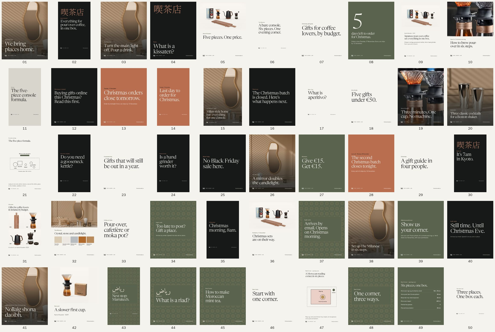

# Marketing

The Home Lab's launch marketing: the plan, the first 50 social posts with finished creatives, and the advertising plan. It covers 5 November 2026 to 31 January 2027.

Everything here works without shoots, recorded voiceovers or samples in hand. Every creative is built from the supplier photos of the actual pieces (`public/images`), the brand fonts and colours, drawn plans and words. No AI-generated imagery is used.



## What's here

| File | What it is |
| --- | --- |
| [01-marketing-plan.md](01-marketing-plan.md) | Strategy, positioning, audiences, channels, the 90-day plan, budget, measurement and rules |
| [02-social-posts.md](02-social-posts.md) | The first 50 posts: date, time, platform, headline, every slide's text, caption, hashtags, alt text and how each is made |
| [03-advertising-plan.md](03-advertising-plan.md) | Paid media: budgets at three levels, Meta, Google, Pinterest and TikTok set-up, ad copy, tracking and testing rules |
| [social-calendar.csv](social-calendar.csv) | All 50 posts as 127 rows (one per network), with captions ready per network, tracked links and media paths, for a scheduler |
| `creatives/post-NN/` | Finished images for each post (`slide-*.jpg`, `frame-*.jpg`), silent reels (`reel.mp4`), Story versions (`story-*.jpg`) and alternates (`*-alt.jpg`) |
| `tools/` | The source: `posts.mjs` (all post content), `render.mjs` (makes the images and reels), `build-docs.mjs` (writes the post guide and CSV), and the brand fonts |

## Do this first (today and tomorrow)

The Christmas batch closes on **Tuesday 17 November**. In order:

1. **Decide the budget** (recommended €4,500 over three months; €1,800 of it in the first 12 days).
2. **Claim the handles**: the same one on Instagram, Facebook, TikTok and Pinterest, for example `@thehomelab.ie`. Avoid anything that reads as "homelab", the tech hobby.
3. **Pass the launch gate** before spending on ads: site in production, a real test order, tracking after consent, prices confirmed (plan, section 8).
4. **Load `social-calendar.csv`** into a scheduler and post #1 on Friday 6 November.
5. **Make decisions 1 to 3** (second Christmas batch, e-gift cards, Christmas returns window). Posts that depend on them already have finished alternates.
6. **Email the gift-guide press list and two or three Irish roasters** (plan, section 7).

## Changing a post

Edit the post in `tools/posts.mjs`, then:

```bash
node marketing/tools/render.mjs 12 13
```

```bash
node marketing/tools/build-docs.mjs
```

The first command re-renders only the posts you name (leave the numbers off to render all 50; it takes about three minutes). It needs Playwright with Chromium and ffmpeg. The second rewrites `02-social-posts.md` and `social-calendar.csv`.

## Notes

- Prices and dates are the shop's on 5 November 2026 (`src/lib/content/sets.ts`, `addons.ts`, `batches.ts`). The catalogue still labels them sample prices: confirm them before any ad runs, and re-render if they change.
- Confirm with each supplier, in writing, that their product photos may be used in social posts and ads.
- Fonts in `tools/fonts` are Newsreader, Hanken Grotesk, Noto Serif JP (subset) and Amiri (subset), all under the SIL Open Font License.
